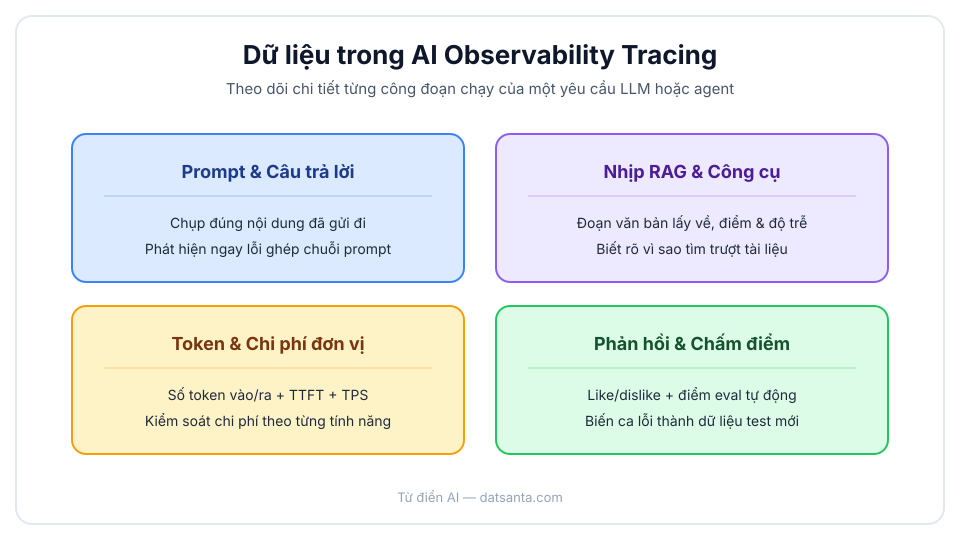

# AI Observability (Giám sát & Truy vết AI)

**AI observability** ghi lại toàn bộ dấu vết chi tiết của từng lượt gọi LLM—prompt gửi đi, các đoạn [RAG](rag.md) lấy về, công cụ đã gọi, số token, độ trễ và lỗi—giúp lập trình viên dễ dàng gỡ lỗi câu trả lời sai và theo dõi sức khỏe hệ thống.

## Ví dụ thực tế

Log web thông thường chỉ ghi `"POST /chat 200 OK 3.2s"`, hoàn toàn vô dụng khi khách hàng báo `"bot báo sai giá sản phẩm"`. Công cụ observability vẽ ra toàn bộ dòng thời gian: bước viết lại câu hỏi mất 200 ms, tìm kiếm vector kéo nhầm 5 đoạn tài liệu cũ, còn LLM chạy mất 2.8s—giúp kỹ sư chỉ ra đúng bước hỏng chỉ trong vài giây.

## Đừng nhầm với

- **[Audit Trail](audit-trail.md):** Audit trail là hồ sơ tuân thủ bất biến chứng minh *ai đã duyệt hành động nào* cho thanh tra; observability là dữ liệu kỹ thuật giúp lập trình viên gỡ lỗi độ trễ, chất lượng tìm kiếm và chi phí token.

## Thuật ngữ liên quan

- [AI Gateway](ai-gateway.md)
- [Post-Deployment Monitoring](post-deployment-monitoring.md)
- [Token Counting](token-counting.md)
