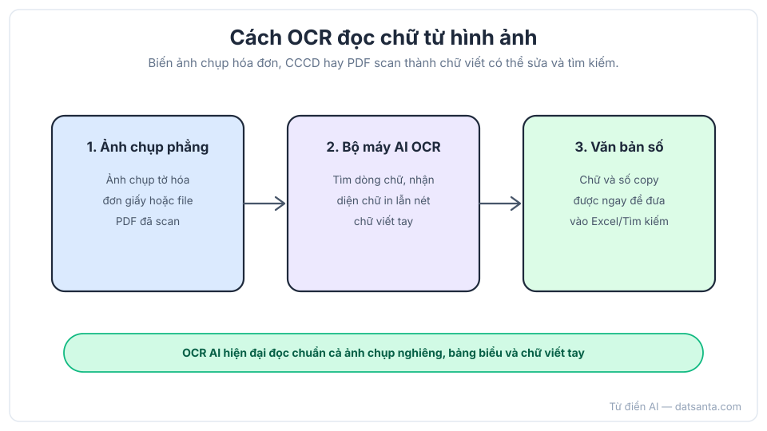

# OCR (Nhận dạng ký tự quang học)

**OCR** (Optical Character Recognition) là công nghệ đọc chữ bên trong hình ảnh, file PDF scan hoặc ảnh chụp camera — biến bức ảnh phẳng chứa chữ thành văn bản số có thể bôi đen, sửa và tìm kiếm.

## Ví dụ thực tế

Mỗi khi bạn giơ camera app ngân hàng quét hóa đơn giấy, quét căn cước công dân lúc làm thủ tục sân bay, hay copy đoạn chữ thẳng từ ảnh chụp màn hình điện thoại, công nghệ OCR đang đọc chữ giúp bạn.

OCR đời cũ hay bó tay trước ảnh mờ, hóa đơn nghiêng hay chữ viết tay. OCR AI hiện đại kết hợp [computer vision](computer-vision.md) và hiểu ngôn ngữ để trích xuất chính xác cả bảng biểu lẫn nét chữ tay.

## Đừng nhầm với

- **Chụp ảnh hay scan thành PDF:** Máy scan thông thường chỉ lưu một *bức ảnh* của trang giấy, bạn không thể bôi đen hay tìm chữ bên trong; OCR chuyển hình dáng nét chữ thành ký tự thật.
- **[Computer vision](computer-vision.md):** Computer vision nhận diện *mọi thứ* trong ảnh (xe cộ, khuôn mặt, thú cưng); OCR là nhánh chuyên biệt chỉ tập trung vào việc đọc chữ.

## Thuật ngữ liên quan

- [Computer Vision](computer-vision.md)
- [Multimodal AI](multimodal-ai.md)
- [RAG](rag.md)
