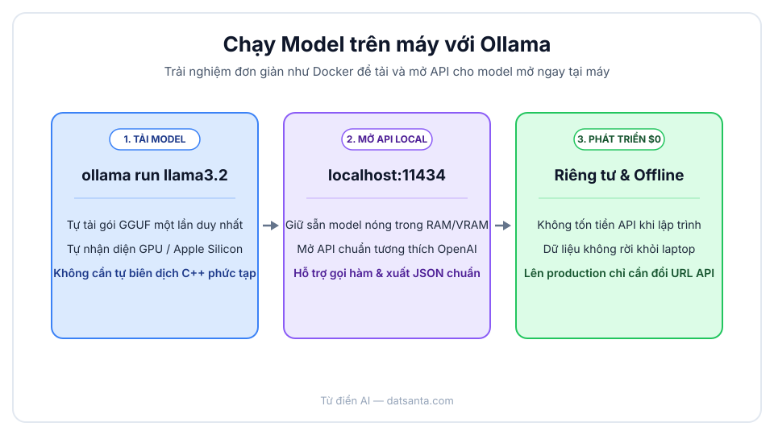

# Ollama (Trình chạy Model nội bộ)

**Ollama** là công cụ dòng lệnh thân thiện giúp lập trình viên tải các model mở (định dạng [GGUF](gguf.md)), tự động quản lý bộ nhớ GPU/CPU và mở sẵn một HTTP API tương thích OpenAI ngay trên máy cá nhân.

## Ví dụ thực tế

Trước đây, muốn chạy model mở trên máy tính cá nhân bạn phải tự biên dịch C++ hoặc vật lộn với môi trường CUDA hàng giờ. Với Ollama, gõ `ollama run llama3.2` đơn giản hệt như `docker run`: nó tự tải trọng số nén, bật server nền ở `localhost:11434` và cho phép code của bạn thử nghiệm prompt hay [structured outputs](structured-outputs.md) offline với chi phí API bằng 0 đồng.

## Đừng nhầm với

- **[vLLM](vllm.md):** Ollama sinh ra để một lập trình viên chạy thử và phát triển cực nhanh trên máy cá nhân; vLLM sinh ra cho cụm GPU production phục vụ nhiều người dùng đồng thời.

## Thuật ngữ liên quan

- [GGUF Format](gguf.md)
- [vLLM](vllm.md)
- [Quantization](quantization.md)
