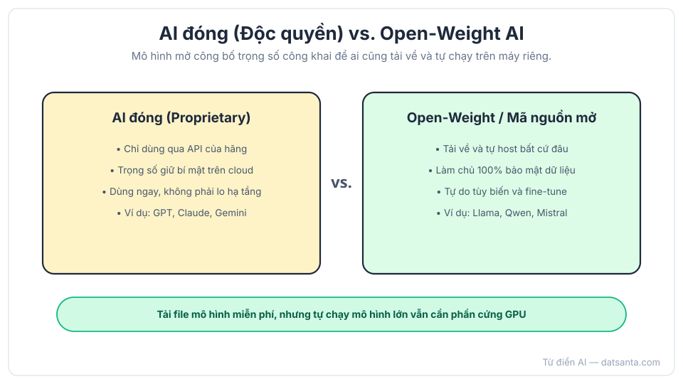

# Open-Source AI (AI mã nguồn mở / Mở trọng số)

**Open-source AI** (chính xác hơn là **open-weight**) chỉ các mô hình AI được công bố công khai bộ trọng số để bất kỳ ai cũng có thể tải về, tùy biến hoặc tự chạy trên máy chủ riêng thay vì phụ thuộc hoàn toàn vào API của một hãng.

## Ví dụ thực tế

Hãy so sánh giữa việc đi ăn ở nhà hàng giữ kín công thức sốt bí mật (mô hình đóng như GPT hay Claude qua API) với việc nhận sẵn gói gia vị chuẩn để tự do nấu nướng trong bếp nhà bạn (mô hình mở như Llama, Mistral, Qwen hay DeepSeek).

Mô hình mở giúp doanh nghiệp làm chủ hoàn toàn [data privacy](data-privacy.md), tránh [vendor lock-in](vendor-lock-in.md) và có thể chạy [local AI](local-ai.md) ngoại tuyến.

## Đừng nhầm với

- **Chạy hoàn toàn miễn phí:** Tải file mô hình không mất tiền, nhưng để chạy mượt một mô hình lớn 70B bạn vẫn tốn tiền điện và GPU mạnh (hoặc phí thuê máy chủ).
- **Công khai 100% dữ liệu huấn luyện:** Nhiều bản phát hành "open-source" chỉ mở trọng số và code, còn giữ kín [training data](training-data.md) gốc — vì vậy giới chuyên môn thường gọi chuẩn hơn là *open-weight*.

## Thuật ngữ liên quan

- [Local AI](local-ai.md)
- [Cloud AI](cloud-ai.md)
- [Foundation Model](foundation-model.md)
- [Vendor Lock-in](vendor-lock-in.md)
