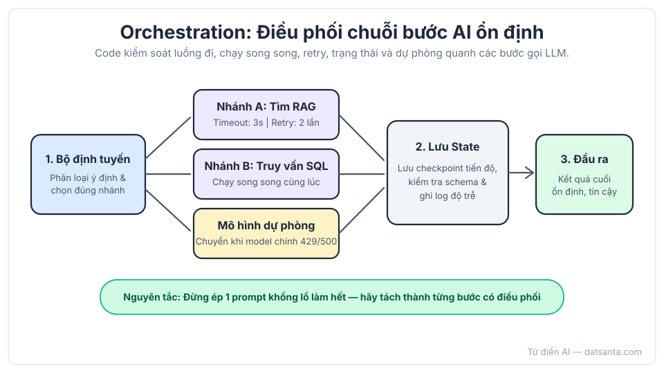

# Orchestration (Điều phối AI)

**Orchestration** là lớp code ứng dụng đứng ra điều phối nhiều lời gọi [LLM](llm.md), nhánh rẽ logic, tác vụ chạy song song, cơ chế retry, lưu trạng thái và mô hình dự phòng thành một pipeline ổn định.

## Ví dụ đời thường

Ép một prompt duy nhất tự phân loại ý định, tìm tài liệu, xuất JSON và gửi email giống như bắt một nhạc công chơi cùng lúc năm nhạc cụ.

Orchestration đóng vai nhạc trưởng: bộ định tuyến chọn nhánh phù hợp, các worker chạy [RAG](rag.md) và truy vấn SQL song song với timeout 3 giây, lời gọi lỗi tự chuyển sang model dự phòng, còn checkpoint giúp job dài chạy tiếp mượt mà nếu lỡ sập.

## Đừng nhầm với

- **Nối chuỗi prompt (Chaining):** Nối đầu ra A sang prompt B chỉ là chuỗi tuyến tính đơn giản; orchestration xử lý rẽ nhánh, song song hóa, khôi phục lỗi, log và [rate limiting](rate-limiting.md).
- **[AI agent](ai-agent.md) tự trị:** Agent để LLM tự quyết đường đi; orchestration dùng code tất định kiểm soát chặt các luồng nghiệp vụ quan trọng.

## Thuật ngữ liên quan

- [AI Workflow](ai-workflow.md)
- [AI Agent](ai-agent.md)
- [Rate Limiting](rate-limiting.md)
- [MCP](mcp.md)
