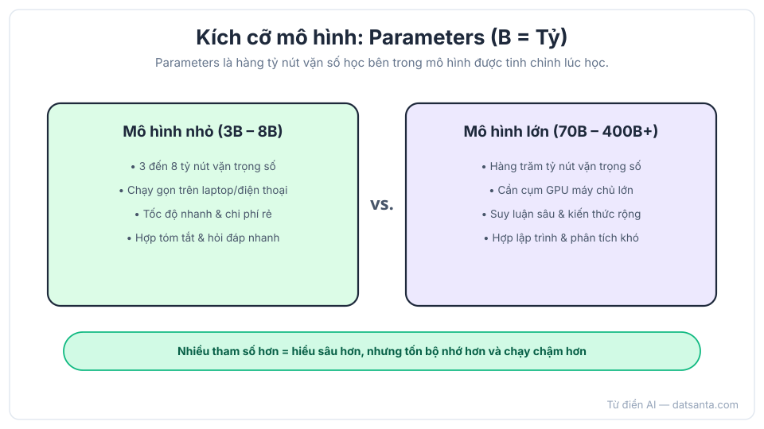

# Parameters (Tham số mô hình)

**Parameters** (hay trọng số) là hàng triệu đến hàng tỷ con số nhỏ bên trong một mô hình AI được tinh chỉnh trong quá trình huấn luyện để mô hình biết cách trả lời chính xác.

## Ví dụ thực tế

Hãy tưởng tượng một bàn chỉnh âm thanh khổng lồ trong phòng thu phủ kín hàng nghìn cần gạt. Nhích nhẹ từng cần gạt sẽ làm bản nhạc nghe trong và chuẩn hơn.

Khi bạn thấy tên gọi như **"Llama 8B"** hay **"70B"**, chữ `B` viết tắt của **tỷ parameters** — tức 8 tỷ hoặc 70 tỷ nút vặn số học đã được chỉnh qua lúc học. Càng nhiều tham số thường chứa càng nhiều kiến thức, nhưng đòi hỏi GPU lớn và tốn kém hơn để chạy.

## Đừng nhầm với

- **[Token](token.md):** Token là mảnh văn bản chạy *vào* hoặc *ra* khỏi mô hình; parameters là các con số cố định lưu *bên trong* file mô hình.
- **Tham số API (như [temperature](temperature.md)):** Lập trình viên cũng hay gọi tùy chọn API là tham số, nhưng khi gắn trong tên mô hình (`7B`, `70B`), parameters luôn chỉ số lượng trọng số nội tại.

## Thuật ngữ liên quan

- [Neural Network](neural-network.md)
- [Quantization](quantization.md)
- [LLM](llm.md)
- [LoRA](lora.md)
