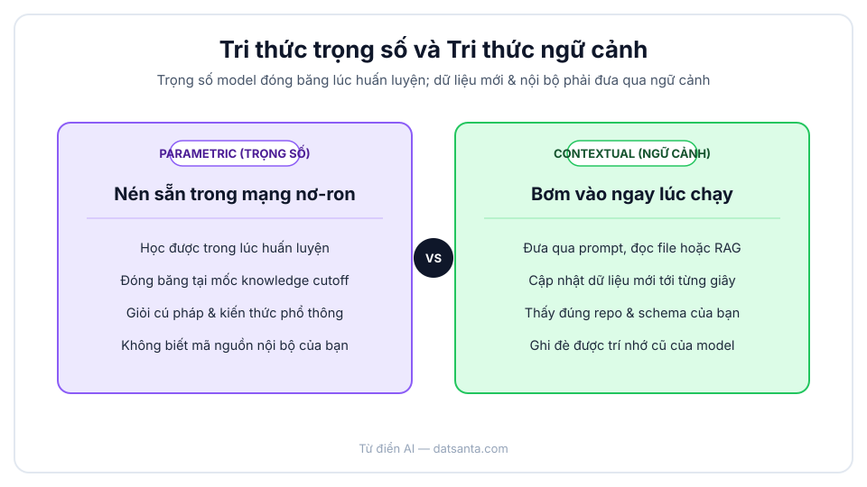

# Parametric Knowledge (Tri thức trong trọng số)

**Parametric knowledge** là toàn bộ kiến thức, cú pháp lập trình và mẫu suy luận được nén sẵn bên trong các trọng số mạng nơ-ron của model trong lúc huấn luyện—và bị đóng băng tại mốc [knowledge cutoff](knowledge-cutoff.md).

## Ví dụ thực tế

Hãy hình dung mọi kiến thức bác sĩ nhớ trong đầu từ thời học trường y mà không cần mở sách: đó là parametric knowledge. Còn việc mở hồ sơ xét nghiệm mới nhất của bệnh nhân trên bàn để đọc là *tri thức ngữ cảnh (contextual knowledge)* đưa qua prompt hoặc [RAG](rag.md). Chỉ dựa vào parametric knowledge sẽ bó tay với mã nguồn nội bộ hay thư viện mới ra mắt, nên coding [harness](harness.md) luôn đọc file thật vào ngữ cảnh.

## Đừng nhầm với

- **[RAG](rag.md):** Parametric knowledge nằm cố định trong trọng số model; RAG bơm thêm *tri thức ngữ cảnh* mới mẻ từ bên ngoài vào prompt ngay lúc chạy.

## Thuật ngữ liên quan

- [Knowledge Cutoff](knowledge-cutoff.md)
- [Parameters](parameters.md)
- [RAG](rag.md)
