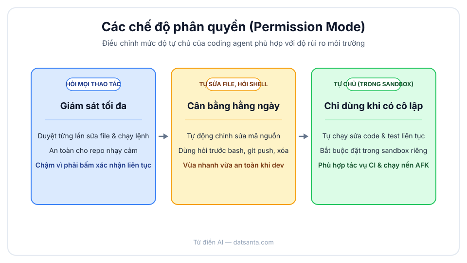

# Permission Mode (Chế độ phân quyền Agent)

**Permission mode** là thiết lập an toàn trong coding [harness](harness.md) quy định thao tác nào AI agent được phép tự chạy luôn và thao tác rủi ro nào (như chạy lệnh shell hay xóa file) bắt buộc phải dừng lại xin người dùng xác nhận.

## Ví dụ thực tế

Hãy hình dung lộ trình trao quyền cho người mới học lái xe: ban đầu luôn có người kèm bên cạnh (`Hỏi mọi thao tác`), sau đó tự lái trên đường quen thuộc (`Tự sửa file, nhưng hỏi khi chạy lệnh Shell`), và cuối cùng là tự chủ hoàn toàn trên đường chạy thử an toàn (`Tự chạy / Bypass` bên trong một [sandbox](sandbox.md) cô lập). Chọn đúng permission mode theo mức độ rủi ro giúp lập trình vừa nhanh vừa tránh thảm họa `rm -rf`.

## Đừng nhầm với

- **[Sandbox](sandbox.md):** Sandbox là bức tường hệ điều hành/container giới hạn *những gì máy tính chạm tới được*; permission mode là quy tắc giao diện của harness quyết định *khi nào phải dừng lại hỏi người dùng*.

## Thuật ngữ liên quan

- [Harness](harness.md)
- [Sandbox](sandbox.md)
- [AFK Agent](afk-agent.md)
