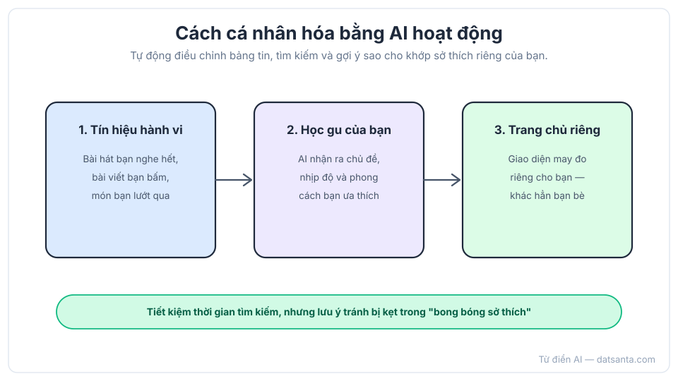

# Personalization (Cá nhân hóa)

**Personalization** là việc dùng AI tự động điều chỉnh nội dung, kết quả tìm kiếm, gợi ý sản phẩm hoặc tốc độ học tập sao cho khớp với sở thích và hành vi riêng của từng người dùng.

## Ví dụ thực tế

Hai người bạn mở Spotify hoặc Netflix cùng một giây nhưng thấy hai trang chủ khác hẳn nhau. Một người thấy danh sách nhạc guitar mộc và phim tài liệu; người kia thấy nhạc K-pop và phim khoa học viễn tưởng.

Nhờ nhận ra quy luật từ những gì bạn bấm xem, bỏ qua hay xem hết, AI tự sắp xếp nội dung hiện tiếp theo — giúp bạn đỡ mất công tìm giữa hàng triệu lựa chọn, dù đôi khi dễ nhốt bạn trong "bong bóng sở thích".

## Đừng nhầm với

- **Tự tùy chỉnh thủ công:** Việc bạn tự bật Dark Mode hay tự chọn mục tin yêu thích là tùy chỉnh thủ công; cá nhân hóa diễn ra tự động phía sau.
- **[Recommendation system](recommendation-system.md):** Hệ thống gợi ý là bộ máy đề xuất món cụ thể (*"Có thể bạn sẽ thích..."*); cá nhân hóa là mục tiêu lớn hơn nhằm may đo toàn bộ trải nghiệm.

## Thuật ngữ liên quan

- [Recommendation System](recommendation-system.md)
- [Machine Learning](machine-learning.md)
- [Data Privacy](data-privacy.md)
