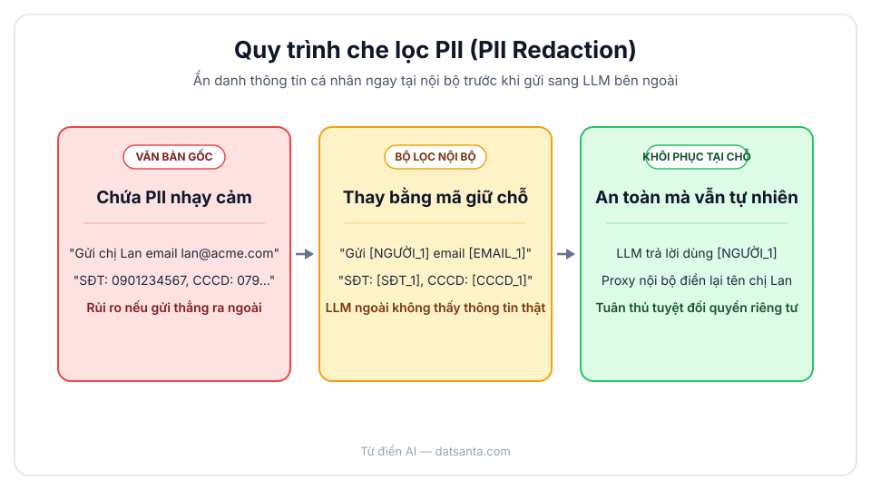

# PII Redaction (Che lọc thông tin cá nhân)

**PII redaction** là bước tiền xử lý tự động quét các prompt và tài liệu chuẩn bị gửi đi để che hoặc thay thế thông tin định danh cá nhân ([PII](pii.md))—như email, số điện thoại, số căn cước—bằng ký hiệu ẩn danh an toàn trước khi gọi LLM bên ngoài.

## Ví dụ thực tế

Trước khi gửi hồ sơ bệnh án sang chuyên gia tư vấn bên ngoài, phòng khám bôi đen họ tên và số căn cước của bệnh nhân rồi thay bằng `"Bệnh nhân A"`. Trong code, bộ lọc PII redaction biến `"Gọi chị Lan số 0901234567"` thành `"Gọi [NGƯỜI_1] số [SĐT_1]"`, để LLM soạn câu trả lời theo mã ẩn đó rồi hệ thống tự điền lại tên thật ở máy chủ nội bộ.

## Đừng nhầm với

- **[Zero Data Retention](zero-data-retention.md):** Zero data retention là *cam kết hợp đồng* phía nhà cung cấp sẽ xóa prompt sau khi trả lời; PII redaction đảm bảo dữ liệu cá nhân nhạy cảm *không bao giờ rời khỏi máy chủ của bạn* ngay từ đầu.

## Thuật ngữ liên quan

- [PII](pii.md)
- [Zero Data Retention](zero-data-retention.md)
- [AI Gateway](ai-gateway.md)
