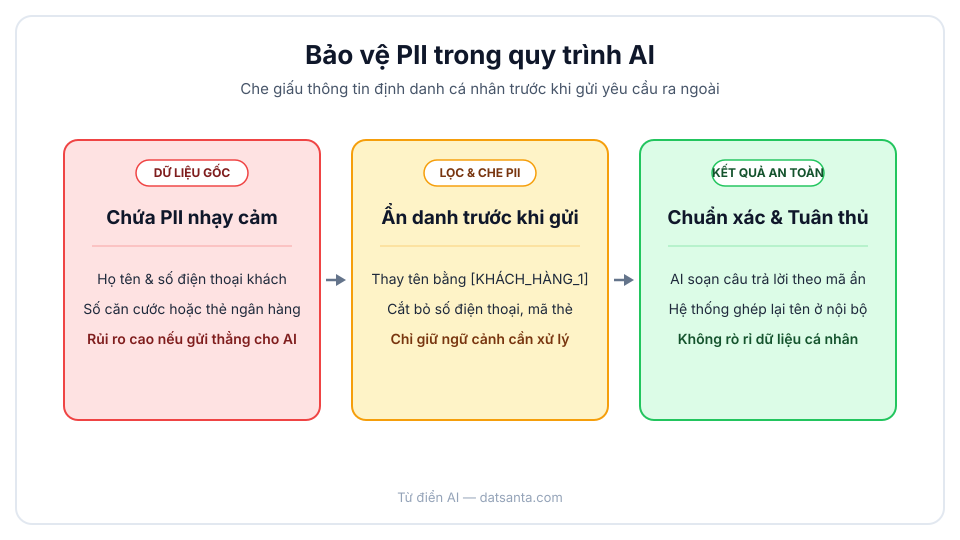

# PII (Thông tin định danh cá nhân)

**PII (Personally Identifiable Information)** là mọi dữ liệu có thể giúp nhận diện ra một cá nhân cụ thể—như họ tên đầy đủ, số điện thoại, email, số căn cước, địa chỉ nhà hoặc tài khoản ngân hàng.

## Ví dụ thực tế

Khi một nhân viên copy nguyên email khiếu nại của khách hàng dán vào chatbot công cộng để nhờ viết câu trả lời lịch sự, đoạn văn đó thường dính kèm số điện thoại, địa chỉ giao hàng và số thẻ của khách. Dù AI viết hay đến mấy, việc đưa PII ra công cụ chưa được duyệt có thể vi phạm luật bảo mật và làm mất uy tín công ty. Hệ thống AI doanh nghiệp an toàn sẽ tự động che hoặc lọc PII trước khi gửi đi.

## Đừng nhầm với

- **[Data Governance](data-governance.md):** PII là một nhóm dữ liệu cá nhân nhạy cảm cụ thể; data governance là khung quy định tổng thể để quản lý mọi loại dữ liệu của công ty.

## Thuật ngữ liên quan

- [Zero Data Retention](zero-data-retention.md)
- [Compliance](compliance.md)
- [Guardrails](guardrails.md)
