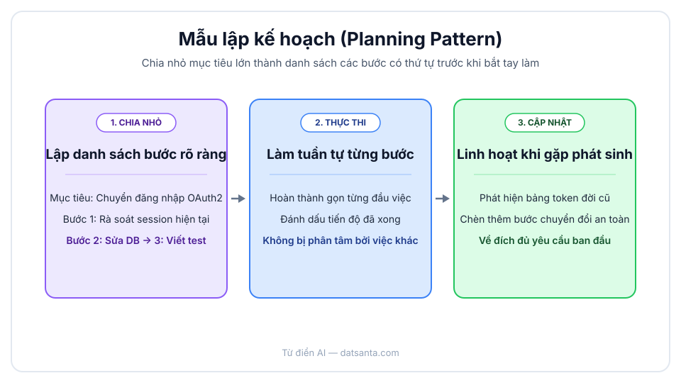

# Planning Pattern (Mẫu lập kế hoạch trước)

**Planning pattern** hướng dẫn agent chia nhỏ một mục tiêu phức tạp thành danh sách các bước con có thứ tự ngay từ đầu trước khi lần lượt thực thi từng bước, và cập nhật lại kế hoạch nếu gặp trở ngại mới.

## Ví dụ thực tế

Trước khi sửa phòng tắm, nhà thầu luôn viết sẵn bảng công việc theo thứ tự: khóa van nước, đục gạch cũ, đi lại ống nước, lát gạch, lắp thiết bị. Nhảy vào cầm búa đục ngay không có kế hoạch rất dễ phải làm đi làm lại tốn kém. Khi AI agent xử lý bài toán nghiên cứu hay lập trình nhiều bước, tạo kế hoạch rõ ràng trước giúp nó không quên yêu cầu ban đầu ở giữa chừng.

## Đừng nhầm với

- **[Reflection Pattern](reflection-pattern.md):** Planning sắp xếp *những bước nào cần làm tiếp* trước khi hành động; reflection kiểm tra và sửa *kết quả đã làm ra*.

## Thuật ngữ liên quan

- [Reflection Pattern](reflection-pattern.md)
- [ReAct Pattern](react-pattern.md)
- [Orchestration](orchestration.md)
