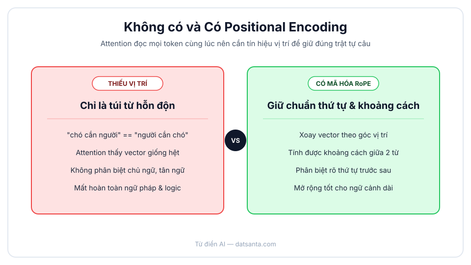

# Positional Encoding (Mã hóa vị trí)

**Positional encoding** đưa thông tin thứ tự vào vector của từng token để [Transformer](transformer.md) phân biệt được `"chó cắn người"` khác với `"người cắn chó"`, vì cơ chế attention đọc toàn bộ các token cùng một lúc.

## Ví dụ thực tế

Hãy tưởng tượng bạn đổ 20 quân cờ chữ cái xuống bàn cùng lúc—nếu không đánh số `1, 2, 3...`, người nhìn vào chỉ thấy một đống chữ rời rạc không biết thứ tự trước sau. Các LLM hiện đại thường dùng RoPE (Rotary Positional Embedding), xoay nhẹ vector của mỗi token một góc tỷ lệ với vị trí của nó, giúp attention đo chính xác khoảng cách tương đối giữa hai từ bất kỳ ngay cả trong tài liệu dài.

## Đừng nhầm với

- **[Embeddings](embeddings.md):** Token embeddings mã hóa *ý nghĩa* của từ; positional encoding mã hóa *vị trí đứng* của token đó trong câu.

## Thuật ngữ liên quan

- [Transformer](transformer.md)
- [Attention Mechanism](attention-mechanism.md)
- [Context Window](context-window.md)
