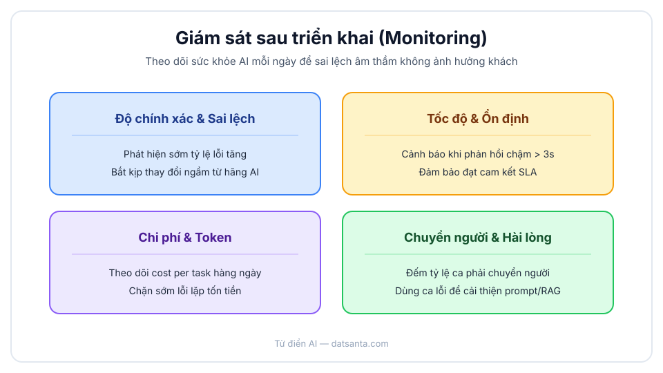

# Post-Deployment Monitoring (Giám sát sau triển khai)

**Post-deployment monitoring** là việc theo dõi liên tục hệ thống AI *sau khi* đã đưa vào vận hành chính thức để phát hiện sớm tình trạng tụt độ chính xác, chi phí tăng bất thường, chậm phản hồi hay lỗi an toàn trước khi khách hàng gặp sự cố.

## Ví dụ thực tế

Ra mắt một ứng dụng giao hàng mới không có nghĩa là kỹ sư xóa hết bảng theo dõi ngay ngày hôm sau. Dù chatbot hỗ trợ đã vượt qua mọi bài kiểm tra vào tháng Một, chỉ một bản cập nhật nhỏ từ hãng cung cấp model hay danh mục sản phẩm mới vào tháng Tư cũng có thể làm AI trả lời sai hoặc chậm gấp đôi. Giám sát liên tục giúp theo dõi tỷ lệ lỗi, số ca chuyển người và chi phí token mỗi ngày.

## Đừng nhầm với

- **[AI Pilot](ai-pilot.md):** Pilot là đợt chạy thử ngắn hạn trước khi quyết định triển khai rộng; post-deployment monitoring chạy xuyên suốt khi hệ thống đã phục vụ khách hàng thật.

## Thuật ngữ liên quan

- [Model Risk Management](model-risk-management.md)
- [Audit Trail](audit-trail.md)
- [SLA](sla.md)
