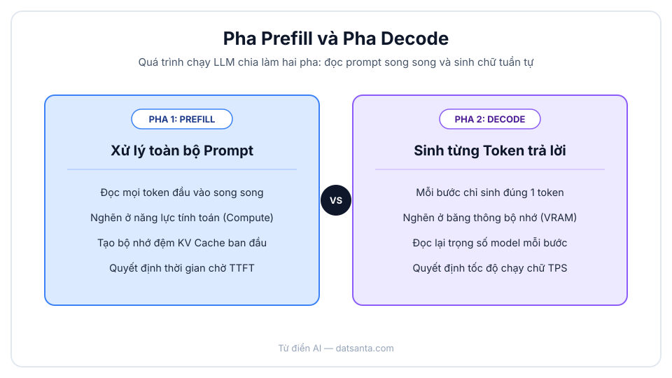

# Prefill and Decode (Nạp ngữ cảnh & Giải mã)

**Prefill** và **decode** là hai pha tách biệt khi chạy inference LLM: prefill xử lý song song toàn bộ prompt đầu vào cùng lúc, còn decode sinh câu trả lời tuần tự từng token một.

## Ví dụ thực tế

Nấu một bữa tiệc lớn có hai công đoạn: sơ chế và ra món. Ở pha sơ chế (prefill), 10 phụ bếp cùng thái rau củ một lúc—tốn nhiều sức tính toán nhưng xong trong một nhịp. Ở pha ra món (decode), đầu bếp phải bày từng đĩa nối tiếp nhau—bị giới hạn bởi tốc độ đọc bộ nhớ. Vì vậy prompt quá dài làm chậm chữ đầu tiên (prefill), còn câu trả lời dài làm chậm thời gian chạy xong (decode).

## Đừng nhầm với

- **[TTFT (Time to First Token)](ttft.md):** Prefill và decode là hai pha xử lý bên trong GPU; TTFT là chỉ số thời gian đo xem pha prefill mất bao lâu trước khi token đầu tiên hiện ra.

## Thuật ngữ liên quan

- [TTFT](ttft.md)
- [TPS (Tokens per Second)](tps.md)
- [KV Cache](kv-cache.md)
