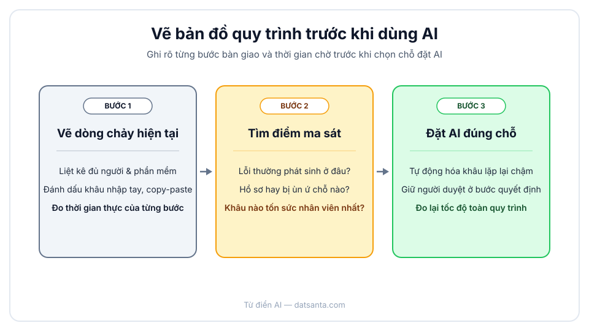

# Process Mapping (Vẽ bản đồ quy trình)

**Process mapping** là việc ghi lại đầy đủ từng bước cách một công việc đang diễn ra hiện tại—ai làm gì, dùng phần mềm nào và hay tắc ở đâu—trước khi quyết định đưa AI vào hỗ trợ khâu nào.

## Ví dụ thực tế

Trước khi sửa lại một căn bếp nhà hàng đông khách, bạn phải vẽ xem đơn hàng đi từ phục vụ sang bếp trưởng rồi ra món như thế nào. Chỉ khi vẽ ra, bạn mới thấy đầu bếp mất nửa thời gian chỉ để đi bộ lấy nước sốt ở kho. Trong doanh nghiệp, vẽ bản đồ quy trình giúp bạn nhận ra AI nên tự động nhập số liệu hóa đơn vào ERP, chứ không phải viết lại email chào hỏi ở bước cuối.

## Đừng nhầm với

- **[Use Case Prioritization](use-case-prioritization.md):** Process mapping vẽ toàn bộ dòng chảy công việc hiện tại; prioritization xếp hạng xem bước nào trong bản đồ đó đáng tự động hóa nhất.

## Thuật ngữ liên quan

- [Bottleneck Analysis](bottleneck-analysis.md)
- [AI Readiness](ai-readiness.md)
- [AI Pilot](ai-pilot.md)
