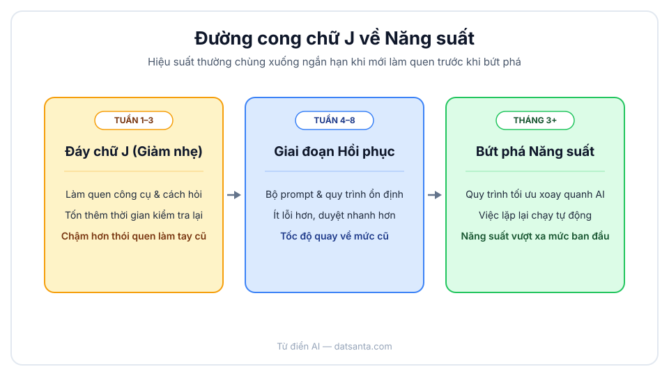

# Productivity J-Curve (Đường cong chữ J về năng suất)

**Productivity J-curve** là hiện tượng năng suất hoặc tốc độ làm việc thường giảm nhẹ ngay sau khi đưa AI vào sử dụng, trước khi đội ngũ quen quy trình mới và hiệu quả tăng vọt vượt mức cũ.

## Ví dụ thực tế

Khi một đội kế toán chuyển từ sổ sách giấy sang phần mềm mới, 2–3 tuần đầu thường chậm hơn làm tay vì mọi người phải học thao tác, sửa lỗi nhập liệu và kiểm tra chéo lại số liệu. Nhưng đến tháng thứ ba, thời gian chốt sổ cuối tháng rút ngắn chỉ còn một nửa. Lãnh đạo nóng vội đòi thấy phép màu ngay tuần đầu thường dễ hủy bỏ những công cụ AI tốt đúng lúc đang ở đáy chữ J.

## Đừng nhầm với

- **[AI Pilot](ai-pilot.md):** Pilot là đợt chạy thử có kiểm soát; J-curve mô tả quy luật hiệu suất "giảm trước, tăng mạnh sau" tự nhiên trong giai đoạn chuyển đổi.

## Thuật ngữ liên quan

- [Change Management](change-management.md)
- [AI Adoption](ai-adoption.md)
- [AI KPI](ai-kpi.md)
