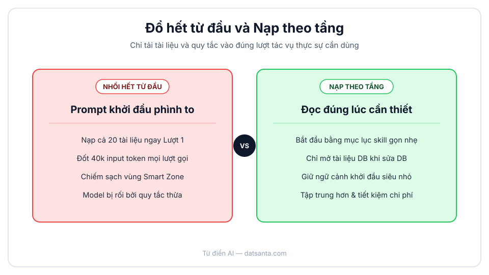

# Progressive Disclosure (Nạp ngữ cảnh theo tầng)

**Progressive disclosure** là kỹ thuật chỉ nạp hướng dẫn, tài liệu dự án hoặc định nghĩa công cụ vào ngữ cảnh của agent *đúng lúc tác vụ hiện tại cần dùng*, thay vì đổ hết mọi quy tắc vào [system prompt](system-prompt.md) ngay từ đầu.

## Ví dụ thực tế

Thực đơn nhà hàng luôn trình bày mục lục các nhóm món gọn gàng thay vì in chi tiết công thức nấu ăn của 100 món ngay trang đầu. Với coding agent, progressive disclosure giữ ngữ cảnh khởi đầu cực nhẹ: [harness](harness.md) chỉ đưa một danh sách ngắn các [skill](skill.md) và đường dẫn tài liệu, và agent chỉ mở `DATABASE_MIGRATIONS.md` đúng lượt nó sửa cơ sở dữ liệu—giữ vững [smart zone](smart-zone.md) và tiết kiệm input token.

## Đừng nhầm với

- **[Compaction](compaction.md):** Compaction dọn bớt rác *sau khi* context window đã đầy; progressive disclosure ngăn rác lọt vào context window ngay từ đầu.

## Thuật ngữ liên quan

- [Skill](skill.md)
- [AGENTS.md](agents-md.md)
- [Smart Zone](smart-zone.md)
