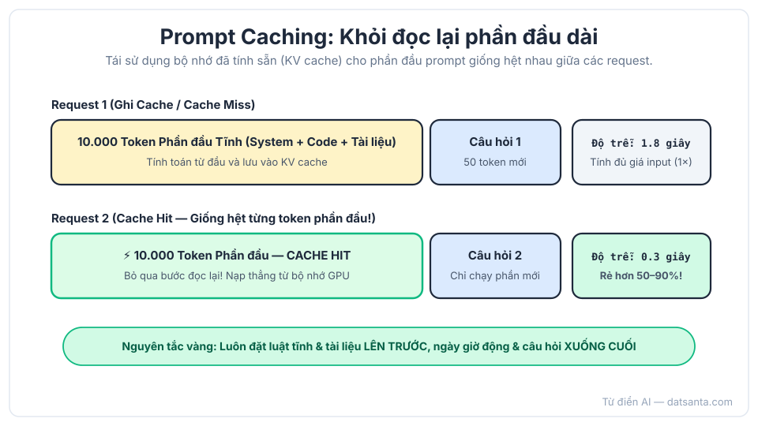

# Prompt Caching

**Prompt caching** lưu và tái sử dụng trạng thái bộ nhớ GPU đã tính sẵn (`KV cache`) cho phần đầu prompt dài lặp đi lặp lại giữa các API call, giúp giảm mạnh cả chi phí lẫn thời gian chờ chữ đầu tiên.

## Ví dụ đời thường

Giả sử trợ lý lập trình của bạn gửi kèm [system prompt](system-prompt.md) và tài liệu dự án dài 10.000 [token](token.md) trong mọi tin nhắn. Nếu không cache, mô hình phải đọc lại từ đầu cả 10.000 token đó ở mỗi lượt hỏi.

Khi bật prompt caching, lượt đầu tiên tính và lưu phần đầu vào bộ nhớ; các lượt sau chỉ cần xử lý câu hỏi mới phía đuôi — phản hồi nhanh hơn tới 80% và giá input phần được cache rẻ hơn 50–90%.

## Đừng nhầm với

- **Cache câu trả lời (Redis):** Response cache trả nguyên văn câu đáp cũ cho câu hỏi giống nhau; prompt caching vẫn sinh câu trả lời mới cho phần đuôi mới, chỉ bỏ qua công đoạn đọc lại phần đầu.
- **Đặt biến động lên đầu prompt:** Nếu bạn chèn ngày giờ hiện tại hay user ID ở dòng 1, cache sẽ trượt (miss) ở mọi request — luôn đặt phần tĩnh lên trước.

## Thuật ngữ liên quan

- [System Prompt](system-prompt.md)
- [Context Window](context-window.md)
- [Latency vs. Throughput](latency-vs-throughput.md)
- [Inference](inference.md)
