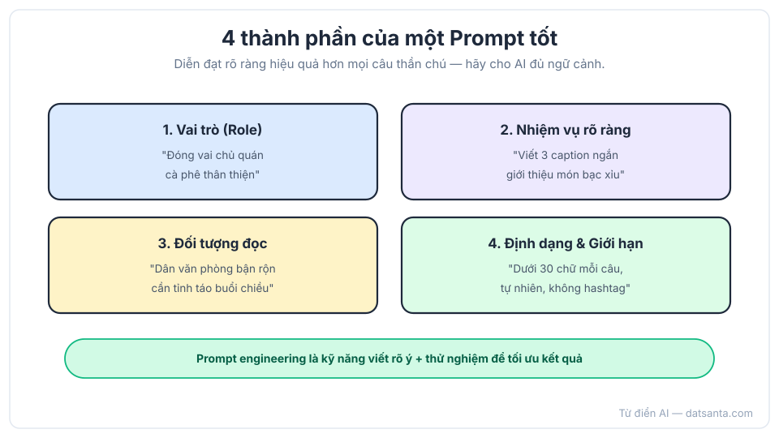

# Prompt Engineering (Kỹ năng viết Prompt)

**Prompt engineering** là kỹ năng thực tế trong việc viết câu lệnh rõ ràng, có cấu trúc để AI luôn trả về kết quả chính xác và dùng được ngay, thay vì những câu trả lời chung chung.

## Ví dụ thực tế

Hai người dùng chung một công cụ AI nhưng nhận kết quả khác hẳn nhau. Một người gõ *"Giúp tôi làm marketing"* và nhận về mấy câu lý thuyết sáo rỗng. Người kia ghi rõ vai trò, đối tượng, mục tiêu và định dạng: *"Đóng vai chủ quán cà phê, viết 3 caption ngắn dưới 30 chữ cho dân văn phòng bận rộn."*

Dù tên gọi nghe có vẻ kỹ thuật, prompt engineering thực chất là kỹ năng giao tiếp rõ ràng và thử nghiệm cách diễn đạt hiệu quả nhất.

## Đừng nhầm với

- **Lập trình (Coding):** Bạn không cần biết viết code để làm tốt prompt engineering; diễn đạt mạch lạc bằng ngôn ngữ tự nhiên mới là kỹ năng chính.
- **[Fine-tuning](fine-tuning.md):** Prompt engineering hướng dẫn mô hình sẵn có bằng câu lệnh hay hơn; fine-tuning huấn luyện lại bản thân mô hình bằng dữ liệu mới.

## Thuật ngữ liên quan

- [Prompt](prompt.md)
- [Few-shot Prompting](few-shot-prompting.md)
- [Zero-shot](zero-shot.md)
- [System Prompt](system-prompt.md)
