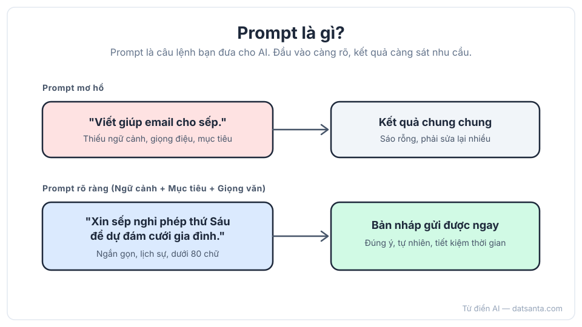

# Prompt

**Prompt** là câu lệnh, câu hỏi hoặc ngữ cảnh bạn nhập vào công cụ AI để nói cho nó biết bạn muốn gì. Prompt của bạn càng rõ ràng, câu trả lời của AI càng sát nhu cầu và dùng được ngay.

## Ví dụ đời thường

Giao tiếp với AI giống như giao việc cho một trợ lý mới. Nếu bạn chỉ nói *"Viết giúp email cho sếp"*, kết quả nhận về sẽ rất chung chung và sáo rỗng. Nhưng nếu bạn nói *"Viết email ngắn dưới 80 chữ, giọng lịch sự, xin sếp nghỉ phép ngày thứ Sáu để dự đám cưới gia đình"*, bạn sẽ có ngay bản nháp gửi đi được luôn.

Một prompt tốt thường có đủ 3 ý: bạn muốn làm gì, gửi cho ai, và giọng văn hay định dạng mong muốn.

## Đừng nhầm với

- **[Context window](context-window.md):** Prompt là tin nhắn hiện tại của bạn; context window là toàn bộ sức chứa cho prompt, file bạn tải lên và cả cuộc trò chuyện.
- **Tìm kiếm Google:** Google tìm các trang web có sẵn khớp từ khóa; còn prompt yêu cầu AI tạo mới hoặc phân tích thông tin riêng cho bạn.

## Thuật ngữ liên quan

- [LLM](llm.md)
- [Context window](context-window.md)
- [Token](token.md)
