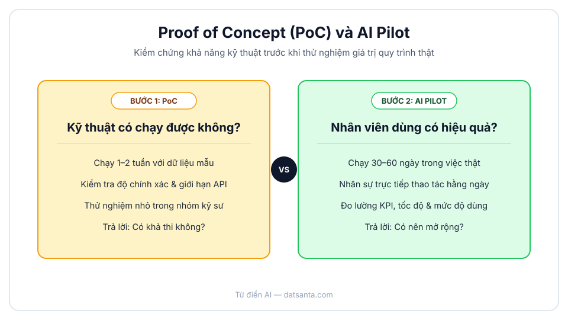

# Proof of Concept (PoC)

**Proof of Concept (PoC)** là bản thử nghiệm nhanh, quy mô nhỏ nhằm kiểm chứng xem một ý tưởng AI có thực sự chạy được về mặt kỹ thuật với dữ liệu của bạn hay không, trước khi đầu tư lớn.

## Ví dụ thực tế

Trước khi ký hợp đồng lắp đặt dây chuyền đóng gói tự động trị giá cả tỷ đồng, chủ xưởng sẽ thử nghiệm trên một máy mẫu với 50 sản phẩm thật để xem máy có bị kẹt nhãn hay không. PoC trong AI cũng vậy: trong vài ngày hoặc 1–2 tuần, đội ngũ kiểm tra xem AI có đọc đúng hóa đơn viết tay hay trả lời chính xác tài liệu nội bộ của công ty bạn không, trước khi viết phần mềm hoàn chỉnh.

## Đừng nhầm với

- **[AI Pilot](ai-pilot.md):** PoC kiểm tra "làm được không" trong môi trường kỹ thuật; AI pilot đưa sản phẩm cho nhân viên thật dùng thử trong quy trình hằng ngày để đo hiệu quả công việc.

## Thuật ngữ liên quan

- [AI Pilot](ai-pilot.md)
- [AI Strategy](ai-strategy.md)
- [Build vs Buy](build-vs-buy.md)
