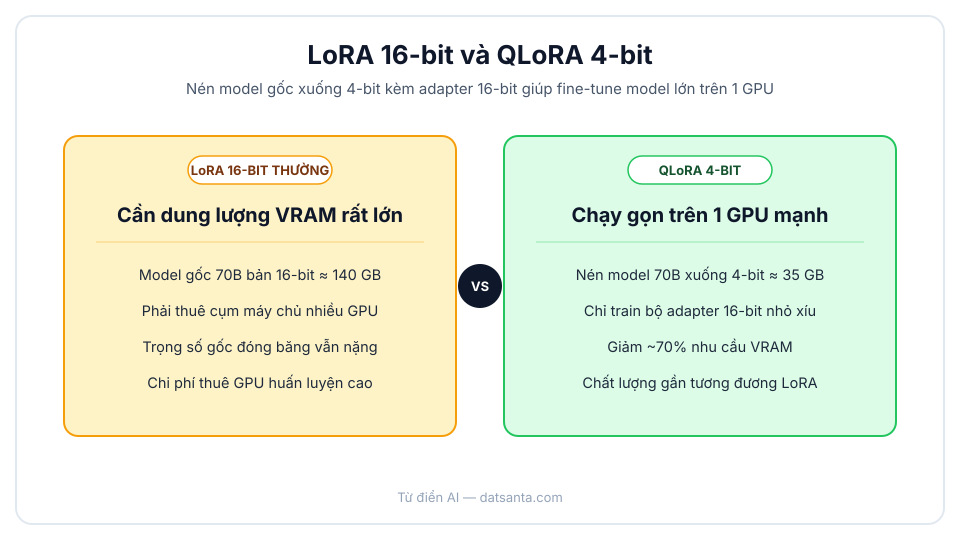

# QLoRA (LoRA Lượng tử hóa)

**QLoRA** kết hợp nén 4-bit ([quantization](quantization.md)) trên model gốc bị đóng băng với các bộ adapter [LoRA](lora.md) nhỏ gọn có thể huấn luyện, giúp lập trình viên fine-tune model lớn ngay trên một GPU phổ thông.

## Ví dụ thực tế

Cải tạo một tòa nhà lịch sử đồ sộ không cần đập bỏ và xây lại toàn bộ tường chịu lực. Bạn giữ nguyên kết cấu khung nặng ở dạng nén gọn và chỉ thiết kế lại vách ngăn nhẹ bên trong. Bằng cách khóa trọng số gốc ở mức 4-bit và chỉ cập nhật các ma trận adapter 16-bit nhỏ xíu, QLoRA giảm khoảng 70% lượng [VRAM](vram.md) cần thiết khi fine-tune mà chất lượng gần như không đổi.

## Đừng nhầm với

- **[LoRA](lora.md):** LoRA tiêu chuẩn giữ model gốc ở độ chính xác 16-bit; QLoRA nén model gốc đó xuống 4-bit để nhét vừa các model lớn hơn nhiều vào cùng dung lượng GPU.

## Thuật ngữ liên quan

- [LoRA](lora.md)
- [Quantization](quantization.md)
- [VRAM](vram.md)
