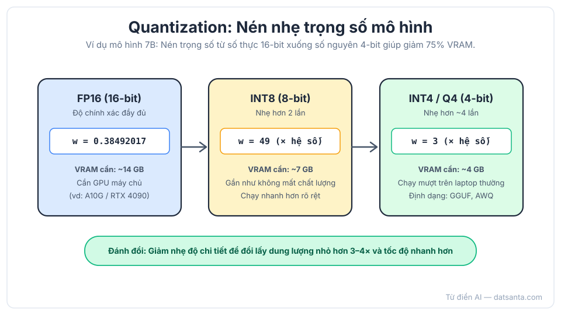

# Quantization (Lượng tử hóa)

**Quantization** nén bộ trọng số của mô hình AI từ số thực độ chính xác cao (như 16-bit) xuống số nguyên gọn nhẹ (8-bit hoặc 4-bit), giúp giảm mạnh bộ nhớ GPU và tăng tốc độ [inference](inference.md).

## Ví dụ thực tế

Hãy nghĩ tới việc lưu ảnh RAW máy cơ thành file JPEG chất lượng cao. Thay vì lưu các số thập phân siêu dài kiểu `0.38492017` cho từng tham số, quantization làm tròn trọng số về thang số nguyên 4-bit hoặc 8-bit gọn hơn.

Một mô hình 7 tỷ tham số bình thường ngốn ~14 GB VRAM ở FP16 sẽ tụt xuống chỉ còn ~4 GB ở bản 4-bit (`Q4` / `AWQ`), giúp bạn chạy mượt mô hình mạnh ngay trên laptop cá nhân.

## Đừng nhầm với

- **Distillation (Chưng cất):** Distillation huấn luyện một mô hình học trò mới nhỏ hơn hẳn; quantization giữ nguyên cấu trúc mô hình cũ, chỉ nén số bit lưu từng trọng số.
- **Pruning (Cắt tỉa):** Pruning xóa bỏ hẳn các kết nối nơ-ron ít tác dụng; quantization giữ đủ mọi trọng số nhưng lưu gọn hơn.

## Thuật ngữ liên quan

- [Inference](inference.md)
- [LoRA](lora.md)
- [Latency vs. Throughput](latency-vs-throughput.md)
