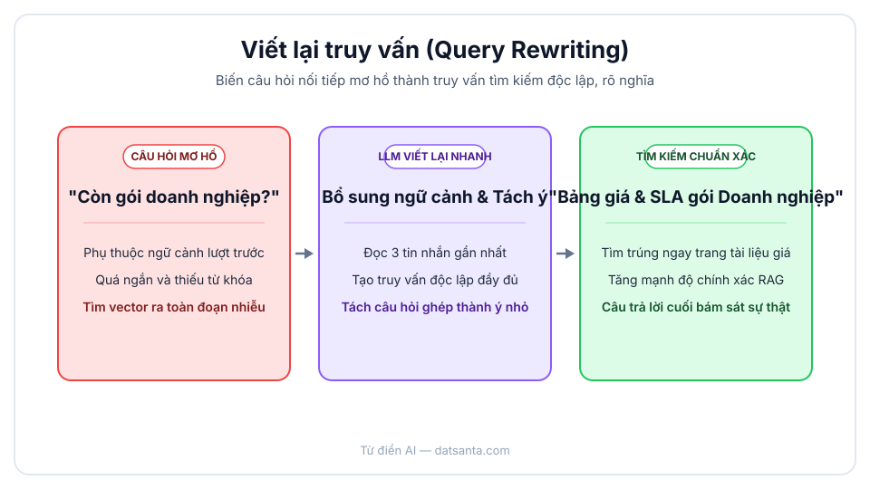

# Query Rewriting (Viết lại truy vấn)

**Query rewriting** dùng một bước gọi LLM nhanh trước khi tìm kiếm để biến câu hỏi lủng củng, mơ hồ hoặc câu hỏi nối tiếp thành các truy vấn tìm kiếm độc lập, rõ nghĩa giúp [RAG](rag.md) lấy trúng tài liệu hơn.

## Ví dụ thực tế

Trong một đoạn chat nhiều lượt, người dùng hỏi tiếp `"Còn gói doanh nghiệp thì sao?"` ngay sau khi vừa hỏi giá gói Cơ bản. Nếu đem nguyên câu `"Còn gói doanh nghiệp thì sao?"` đi tìm trong vector database thì kết quả sẽ rất nhiễu. Bộ viết lại truy vấn sẽ mở rộng thành `"Bảng giá, giới hạn và cam kết SLA của gói Doanh nghiệp"` để tìm trúng ngay tài liệu cần thiết.

## Đừng nhầm với

- **[HyDE](hyde.md):** Query rewriting làm rõ hoặc tách nhỏ bản thân *câu hỏi*; HyDE nhờ LLM viết nháp một *đoạn trả lời giả định* rồi lấy vector của đoạn trả lời đó đi tìm kiếm.

## Thuật ngữ liên quan

- [HyDE](hyde.md)
- [RAG](rag.md)
- [Agentic RAG](agentic-rag.md)
