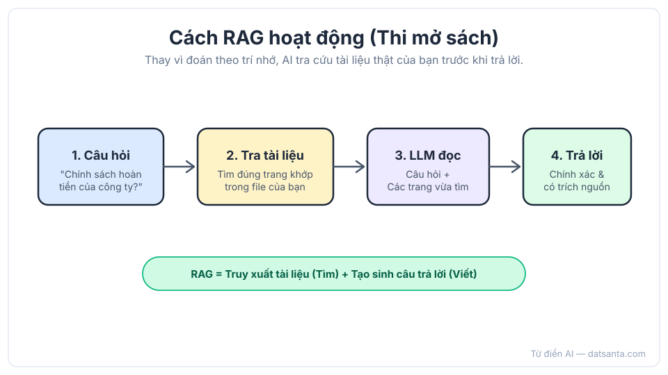

# RAG (Retrieval-Augmented Generation)

**RAG** là kỹ thuật giúp AI tra cứu tài liệu thực tế của bạn trước khi trả lời câu hỏi. Thay vì chỉ dựa vào trí nhớ có sẵn, AI tìm đúng thông tin gốc rồi mới viết câu trả lời.

## Ví dụ thực tế

Hãy so sánh giữa thi đóng sách và thi mở sách. Một [LLM](llm.md) thông thường giống như thí sinh thi đóng sách: nếu quên chính sách hoàn tiền của công ty bạn, nó có thể đoán bừa và gây ra [hallucination](hallucination.md).

RAG cho AI đi thi mở sách. Khi bạn đặt câu hỏi, hệ thống sẽ tìm đúng vài đoạn liên quan trong sổ tay nội bộ hoặc file PDF của bạn, đưa cho AI và dặn: *"Chỉ trả lời dựa trên những trang này thôi."*

## Đừng nhầm với

- **[Fine-tuning](fine-tuning.md):** Fine-tuning huấn luyện lại để AI học phong cách hoặc kỹ năng mới; còn RAG giữ nguyên mô hình và chỉ đưa thêm tài liệu mới lúc bạn hỏi.
- **Tìm kiếm web:** Công cụ tìm kiếm trả về danh sách link để bạn tự đọc; RAG đọc hộ bạn các trang khớp nhất rồi tóm tắt thành câu trả lời trực tiếp.

## Thuật ngữ liên quan

- [Hallucination](hallucination.md)
- [Context window](context-window.md)
- [Fine-tuning](fine-tuning.md)
- [LLM](llm.md)
