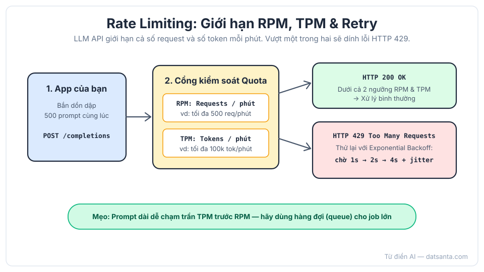

# Rate Limiting (Giới hạn tần suất)

**Rate limiting** là ngưỡng trần mà AI API áp lên số request mỗi phút (`RPM`) và số [token](token.md) mỗi phút (`TPM`) ứng dụng của bạn được phép gửi trước khi nhận lỗi `HTTP 429 Too Many Requests`.

## Ví dụ thực tế

Hãy tưởng tượng trạm thu phí cao tốc có 2 luật: tối đa số xe qua trạm mỗi phút (`RPM`) và tối đa tổng tải trọng mỗi phút (`TPM`). Nếu bạn bắn 50 prompt khổng lồ dài 20.000 token cùng lúc, bạn sẽ đụng trần `TPM` rất lâu trước khi chạm ngưỡng `RPM`.

Code chuẩn production xử lý lỗi `429` bằng **exponential backoff + jitter** (chờ `1s → 2s → 4s` cộng thêm vài mili-giây ngẫu nhiên) hoặc đẩy tác vụ lớn vào hàng đợi chạy nền.

## Đừng nhầm với

- **Hạn mức ngân sách (Budget cap):** Giới hạn chi tiêu tháng sẽ khóa API hẳn khi tiêu hết tiền; rate limit chỉ hãm xung theo giây/phút và tự mở lại ngay sau đó.
- **[Context window](context-window.md):** Context window là giới hạn token trong *một* lần gọi; `TPM` là tổng token cộng dồn của *mọi* lần gọi trong 60 giây.

## Thuật ngữ liên quan

- [Token](token.md)
- [Latency vs. Throughput](latency-vs-throughput.md)
- [Orchestration](orchestration.md)
- [Prompt Caching](prompt-caching.md)
