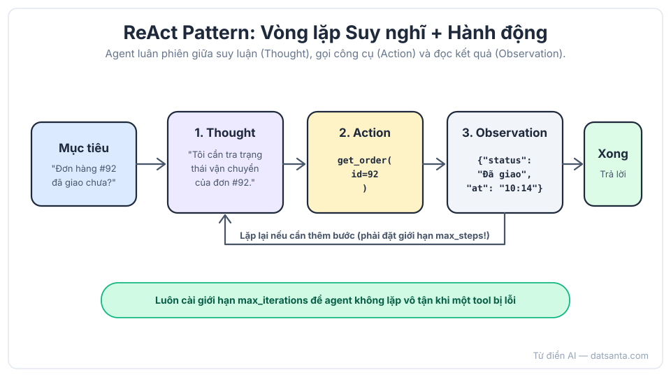

# ReAct Pattern

**ReAct pattern** (Reason + Act) thiết kế [AI agent](ai-agent.md) thành một vòng lặp luân phiên giữa **Thought** (suy nghĩ bước kế tiếp), **Action** (gọi công cụ) và **Observation** (đọc kết quả trả về).

## Ví dụ thực tế

Hãy nghĩ tới lúc bạn debug một lỗi trên production. Bạn không đoán mò cách sửa ngay từ dòng đầu — bạn nghĩ (*"Kiểm tra log lỗi trước"*), hành động (`tail -n 50 app.log`), quan sát (`NullPointerException ở dòng 42`), rồi mới nghĩ bước sửa tiếp theo.

Trong code, vòng lặp ReAct nhét từng `Observation` ngược lại vào [context window](context-window.md) cho tới khi xong việc — luôn kèm giới hạn `max_iterations` để agent không lặp vô tận khi một công cụ bị lỗi.

## Đừng nhầm với

- **[Chain of thought](chain-of-thought.md):** Chain of thought chỉ suy luận thuần túy trong chữ viết, không gọi công cụ ngoài hay nhận phản hồi thực tế.
- **Workflow cố định:** Workflow chạy theo nhánh `if/else` định sẵn; agent kiểu ReAct tự quyết định bước kế tiếp dựa trên kết quả vừa quan sát được.

## Thuật ngữ liên quan

- [AI Agent](ai-agent.md)
- [Function Calling](function-calling.md)
- [Chain of Thought](chain-of-thought.md)
- [Orchestration](orchestration.md)
