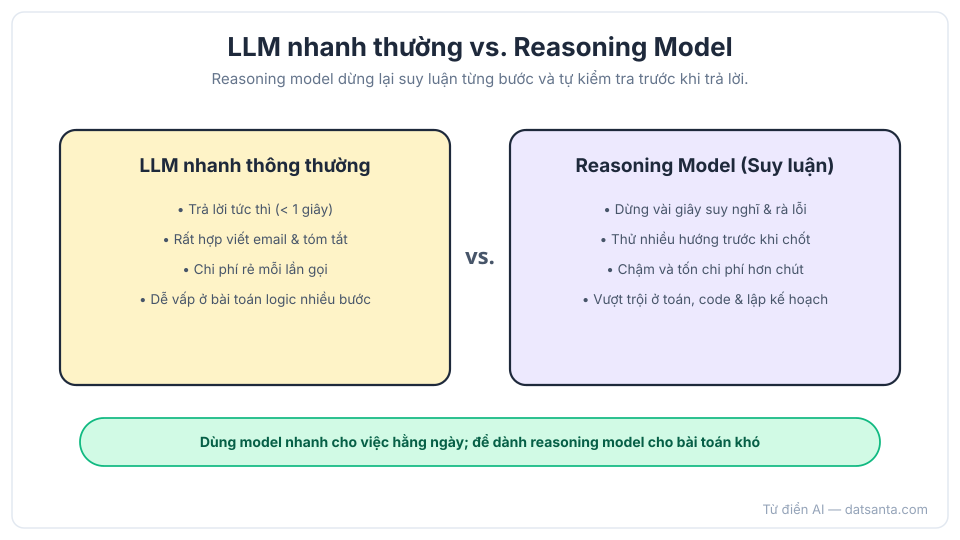

# Reasoning Model (Mô hình suy luận)

**Reasoning model** là mô hình AI được thiết kế để dừng lại và giải quyết bài toán khó từng bước một — tự kiểm tra lại logic của chính mình trước khi hiển thị câu trả lời cuối cho bạn.

## Ví dụ thực tế

Hãy so sánh việc trả lời ngay lập tức *"2 + 2 bằng mấy?"* theo phản xạ với việc cầm giấy bút tính toán lịch trình du lịch 5 ngày đúng ngân sách hay giải một bài toán logic hóc búa.

Các [LLM](llm.md) thông thường bắt đầu trả lời ngay, rất hợp cho viết lách và tóm tắt nhanh. Còn reasoning model dành thêm vài giây suy nghĩ các phương án và tự bắt lỗi của mình — nhờ đó vượt trội hẳn ở toán học, lập trình và lập kế hoạch phức tạp.

## Đừng nhầm với

- **[LLM](llm.md) thông thường:** Mô hình nhanh phản hồi dưới 1 giây và rẻ hơn cho việc hằng ngày; reasoning model chậm và đắt hơn, nên chỉ cần dùng cho bài toán khó.
- **[Chain of thought](chain-of-thought.md):** Chain of thought là mẹo *bạn* chủ động dặn trong prompt; reasoning model được huấn luyện chuyên biệt để tự động suy luận từng bước.

## Thuật ngữ liên quan

- [Chain of Thought](chain-of-thought.md)
- [LLM](llm.md)
- [Hallucination](hallucination.md)
- [AI Agent](ai-agent.md)
