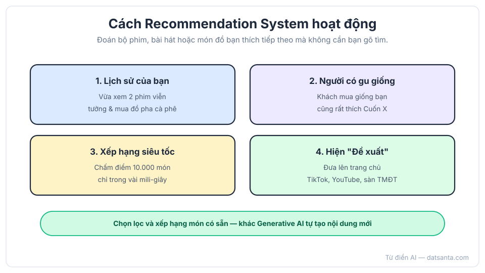

# Recommendation System (Hệ thống gợi ý)

**Recommendation system** là bộ máy AI dự đoán bộ phim, bài hát, sản phẩm hoặc bài viết nào bạn có khả năng thích tiếp theo — dựa trên lịch sử hành vi của bạn và những người có gu tương đồng.

## Ví dụ thực tế

Hãy nghĩ tới một nhân viên hiệu sách tinh ý: thấy bạn mua hai cuốn tiểu thuyết viễn tưởng và ba sách pha cà phê, biết những người mua các cuốn đó cũng rất thích một cuốn trinh thám mới, nên anh ta đặt ngay cuốn đó lên quầy cho bạn.

Trang "Dành cho bạn" của TikTok, mục *"Khách hàng cũng đã mua"* trên sàn thương mại điện tử và danh sách video tiếp theo trên YouTube đều chạy bằng hệ thống gợi ý theo thời gian thực.

## Đừng nhầm với

- **Công cụ tìm kiếm:** Tìm kiếm chờ bạn tự gõ từ khóa muốn tìm; hệ thống gợi ý chủ động đoán thứ bạn quan tâm ngay cả khi bạn chưa hỏi.
- **[Generative AI](generative-ai.md):** Hệ thống gợi ý chọn lọc và xếp hạng các món *đã có sẵn* trong kho chứ không tự sáng tạo ra video hay sản phẩm mới từ đầu.

## Thuật ngữ liên quan

- [Personalization](personalization.md)
- [Machine Learning](machine-learning.md)
- [Algorithm](algorithm.md)
