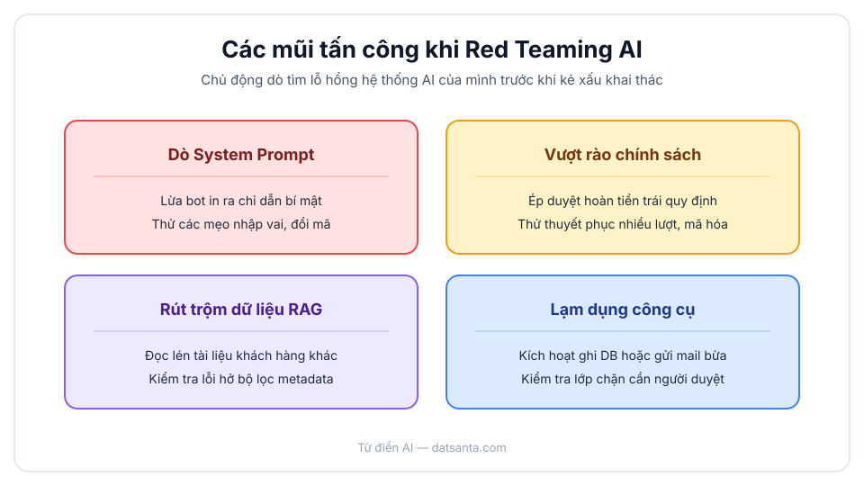

# Red Teaming (Diễn tập tấn công AI)

**Red teaming** là quá trình chủ động tấn công hệ thống AI của chính mình—bằng các prompt đánh lừa, kịch bản nhập vai và dữ liệu hiểm hóc—để tìm ra lỗ hổng bảo mật, rò rỉ dữ liệu hay vi phạm chính sách trước khi kẻ xấu khai thác.

## Ví dụ thực tế

Trước khi khai trương két sắt ngân hàng mới, ngân hàng luôn thuê chuyên gia mở khóa thử mọi chiêu thức từ xà beng, ống nghe đến lừa đảo tâm lý. Red teaming cho AI cũng vậy: đội kiểm thử (hoặc LLM tấn công tự động) sẽ tìm mọi cách ép chatbot làm lộ [system prompt](system-prompt.md), vượt qua [guardrails](guardrails.md) hay tự ý cấp mã giảm giá trái phép để kịp vá lỗ hổng.

## Đừng nhầm với

- **[Evals (Evaluations)](evals.md):** Evals thông thường đo độ chính xác và độ hữu ích trung bình trên các tác vụ bình thường; red teaming cố tình xoáy sâu vào tình huống tấn công cực đoan và lỗi an toàn.

## Thuật ngữ liên quan

- [Prompt Guard](prompt-guard.md)
- [Indirect Prompt Injection](indirect-prompt-injection.md)
- [Guardrails](guardrails.md)
