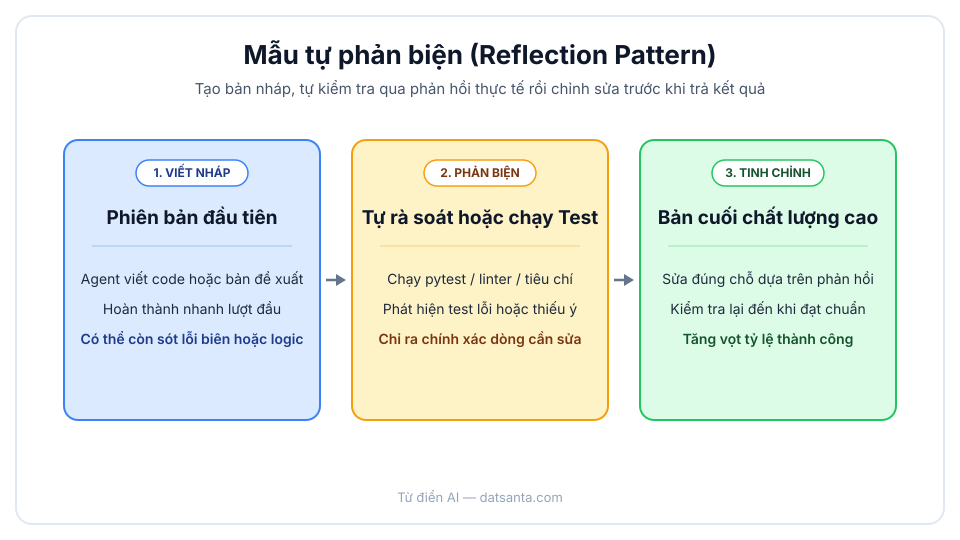

# Reflection Pattern (Mẫu tự phản biện & sửa lỗi)

**Reflection pattern** là thiết kế agent trong đó model tự đánh giá lại bản nháp đầu ra của chính mình (hoặc nhận phản hồi từ trình biên dịch, bộ test tự động) rồi tự sửa qua một hoặc nhiều vòng trước khi trả kết quả cuối.

## Ví dụ thực tế

Người viết giỏi không bao giờ bấm Gửi ngay bản nháp đầu tiên của một đề xuất quan trọng; họ lùi lại đọc kỹ để bắt lỗi logic hay câu chữ lủng củng rồi sửa thành bản thứ hai mượt mà hơn. Với agent lập trình, việc viết hàm xong, chạy `pytest`, đọc lỗi traceback và tự sửa ở vòng lặp thứ hai thường giúp tỷ lệ chạy đúng tăng gấp đôi so với sinh code một lần.

## Đừng nhầm với

- **[Chain of Thought](chain-of-thought.md):** Chain of thought suy nghĩ từng bước *trước khi* chốt câu trả lời trong một lượt; reflection phê bình và cải thiện *bản nháp đã sinh ra* qua nhiều vòng lặp.

## Thuật ngữ liên quan

- [Planning Pattern](planning-pattern.md)
- [ReAct Pattern](react-pattern.md)
- [LLM-as-a-Judge](llm-as-a-judge.md)
