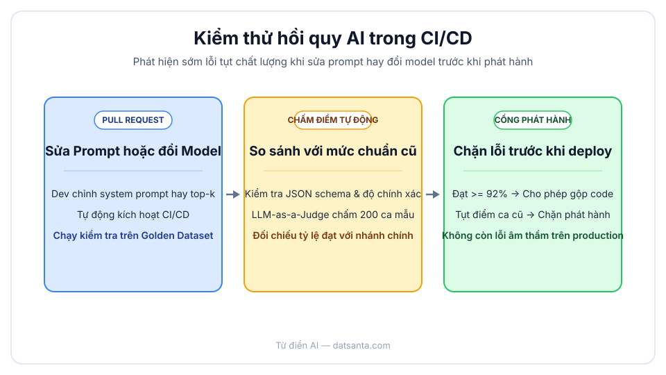

# AI Regression Testing (Kiểm thử hồi quy AI)

**AI regression testing** tự động chạy bộ [evals](evals.md) trên [golden dataset](golden-dataset.md) trong quy trình CI/CD trước mỗi lần triển khai thay đổi prompt, model hay RAG—bắt sớm tình trạng tụt chất lượng âm thầm trước khi đến tay người dùng.

## Ví dụ thực tế

Sửa tiếng kêu ở cửa xe hơi không được phép vô tình làm đứt dây đèn phanh. Khi lập trình viên sửa [system prompt](system-prompt.md) để khắc phục một lỗi phàn nàn mới, họ rất dễ vô tình làm hỏng ba hành vi đúng trước đó. Chạy regression testing tự động trên mỗi pull request sẽ chặn đứng mọi thay đổi làm tỷ lệ đạt rơi xuống dưới ngưỡng an toàn.

## Đừng nhầm với

- **[Post-Deployment Monitoring](post-deployment-monitoring.md):** Regression testing chạy *trước khi* phát hành code trên bộ test cố định; post-deployment monitoring theo dõi lưu lượng *thực tế* sau khi đã lên production.

## Thuật ngữ liên quan

- [Golden Dataset](golden-dataset.md)
- [Evals (Evaluations)](evals.md)
- [Post-Deployment Monitoring](post-deployment-monitoring.md)
