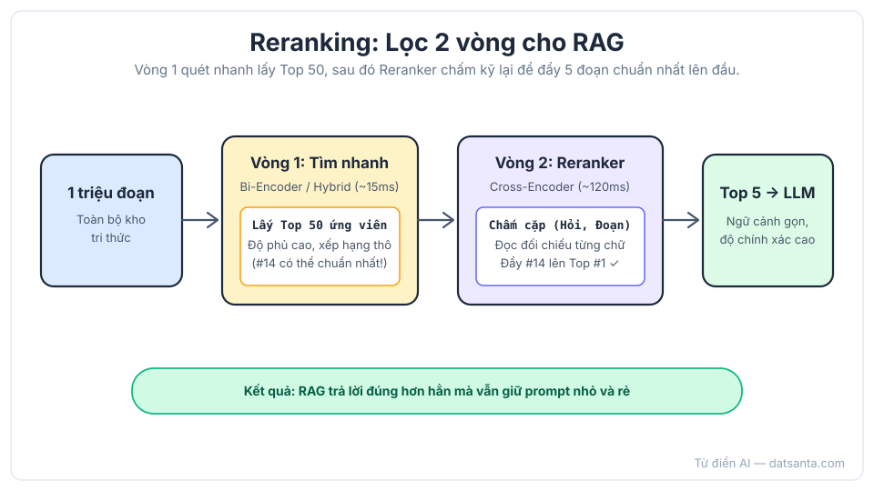

# Reranking (Xếp hạng lại)

**Reranking** là bước chấm điểm vòng hai trong [RAG](rag.md), dùng một mô hình Cross-Encoder chuyên dụng đọc đồng thời câu hỏi kèm từng đoạn ứng viên để đẩy những đoạn sát nghĩa nhất lên vị trí đầu.

## Ví dụ thực tế

Hãy hình dung quy trình tuyển dụng. Vòng 1 (tìm nhanh qua [vector search](vector-database.md) hoặc [hybrid search](hybrid-search.md)) quét 10.000 hồ sơ trong 15ms để nhặt ra 50 ứng viên tiềm năng.

Vòng 2 (Reranker) ngồi đọc kỹ từng cặp (mô tả công việc + CV) đối chiếu với nhau, phát hiện hồ sơ đang xếp thứ `#14` thực ra khớp nhất và đẩy thẳng lên `#1` trước khi gửi đúng Top 5 vào [LLM](llm.md).

## Đừng nhầm với

- **Tìm kiếm vòng đầu (Bi-Encoder):** Vector search mã hóa câu hỏi và tài liệu tách rời nhau để chạy nhanh; Reranker đọc cặp `(câu hỏi, đoạn văn)` cùng lúc nên chậm hơn nhưng chính xác vượt trội.
- **Nhét cả 50 đoạn vào prompt:** Nhồi quá nhiều đoạn vừa tốn [token](token.md), tăng độ trễ, vừa khiến mô hình dễ bỏ sót ý nằm giữa [context window](context-window.md).

## Thuật ngữ liên quan

- [Hybrid Search](hybrid-search.md)
- [RAG](rag.md)
- [Vector Database](vector-database.md)
- [Context Window](context-window.md)
