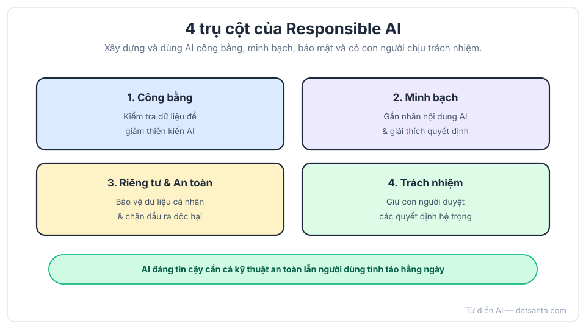

# Responsible AI (AI có trách nhiệm)

**Responsible AI** là nguyên tắc thiết kế, xây dựng và sử dụng hệ thống AI một cách công bằng, minh bạch, an toàn, tôn trọng quyền riêng tư và có con người chịu trách nhiệm rõ ràng.

## Ví dụ thực tế

Giống như nhà sản xuất thực phẩm phải ghi rõ thành phần, tuân thủ vệ sinh và thu hồi lô hàng lỗi, đội ngũ làm AI cũng cần thói quen an toàn tương tự — kiểm tra [AI bias](ai-bias.md), gắn nhãn nội dung do AI tạo, bảo vệ dữ liệu cá nhân và giữ con người quyết định ở các khâu rủi ro cao.

Với người dùng phổ thông, responsible AI đơn giản là dùng AI trung thực, giữ bí mật riêng tư và không tin mù quáng câu trả lời tự động trong y tế, pháp lý hay tài chính.

## Đừng nhầm với

- **Làm chậm đổi mới:** Thực hành an toàn tốt giúp tạo dựng niềm tin bền vững để mọi người yên tâm đưa AI vào công việc và đời sống.
- **[AI alignment](ai-alignment.md):** AI alignment là hướng nghiên cứu kỹ thuật điều chỉnh hành vi mô hình; responsible AI là cam kết rộng hơn về đạo đức, pháp lý và cách con người vận hành AI.

## Thuật ngữ liên quan

- [AI Alignment](ai-alignment.md)
- [AI Bias](ai-bias.md)
- [AI Governance](ai-governance.md)
- [AI Literacy](ai-literacy.md)
