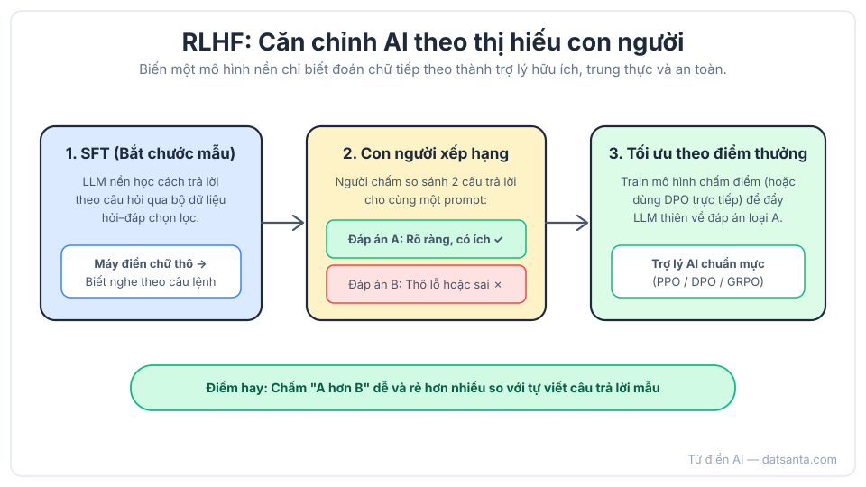

# RLHF (Reinforcement Learning from Human Feedback)

**RLHF** là giai đoạn căn chỉnh sau tiền huấn luyện, nơi mô hình học từ bảng xếp hạng sở thích của con người (`Đáp án A > Đáp án B`) để trở thành trợ lý hữu ích, trung thực và an toàn thay vì cỗ máy điền chữ thô.

## Ví dụ thực tế

Một [LLM](llm.md) mới tiền huấn luyện xong chỉ biết viết tiếp văn bản mạng — bạn hỏi một câu, nó có thể in tiếp năm câu hỏi nữa thay vì trả lời.

Đầu tiên, bước `SFT` dạy nó mẫu hỏi–đáp. Sau đó, người chấm so sánh từng cặp câu trả lời (`A` rõ ràng, lịch sự ✓; `B` thô lỗ ✗). Thuật toán tối ưu (`PPO` hoặc `DPO`) sẽ kéo trọng số mô hình hướng về câu trả lời con người thích.

## Đừng nhầm với

- **Tiền huấn luyện (Pretraining):** Pretraining dạy ngữ pháp, kiến thức và code trên hàng nghìn tỷ token; RLHF định hình giọng điệu, ranh giới từ chối và cách nghe lệnh sau đó.
- **[Fine-tuning](fine-tuning.md) có giám sát (SFT):** SFT bắt chước từng bài mẫu chuẩn; RLHF học từ sự so sánh giữa đáp án tốt và xấu.

## Thuật ngữ liên quan

- [Fine-tuning](fine-tuning.md)
- [LoRA](lora.md)
- [LLM](llm.md)
- [Guardrails](guardrails.md)
