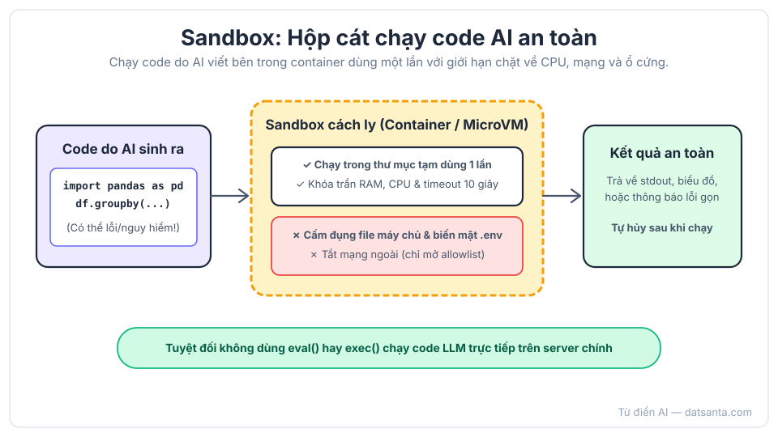

# Sandbox (Môi trường cách ly)

**Sandbox** là môi trường thực thi biệt lập, dùng một lần (như container hoặc microVM) để chạy code do AI sinh ra hoặc lệnh shell của [agent](ai-agent.md) mà không gây nguy hiểm cho máy chủ thật và dữ liệu mật.

## Ví dụ đời thường

Để LLM viết code Python hay Bash rồi gọi thẳng `exec()` trên backend production chẳng khác nào đưa chìa khóa database và file `.env` cho người lạ.

Sandbox nhốt đoạn code đó vào phòng thử nghiệm khóa kín với trần CPU/RAM nghiêm ngặt, timeout 10 giây, chặn đọc ổ cứng máy chủ và ngắt mạng ra ngoài — chỉ trả lại `stdout` hoặc thông báo lỗi rồi hủy sạch container.

## Đừng nhầm với

- **Khối `try/except` trong Python:** Bắt ngoại lệ trong tiến trình chính vẫn dùng chung bộ nhớ, ổ đĩa và biến môi trường với server thật.
- **[Guardrails](guardrails.md):** Guardrails lọc chữ viết vào/ra mô hình; sandbox cô lập việc thực thi code thực tế ở tầng hệ điều hành.

## Thuật ngữ liên quan

- [AI Agent](ai-agent.md)
- [Guardrails](guardrails.md)
- [MCP](mcp.md)
- [Prompt Injection](prompt-injection.md)
