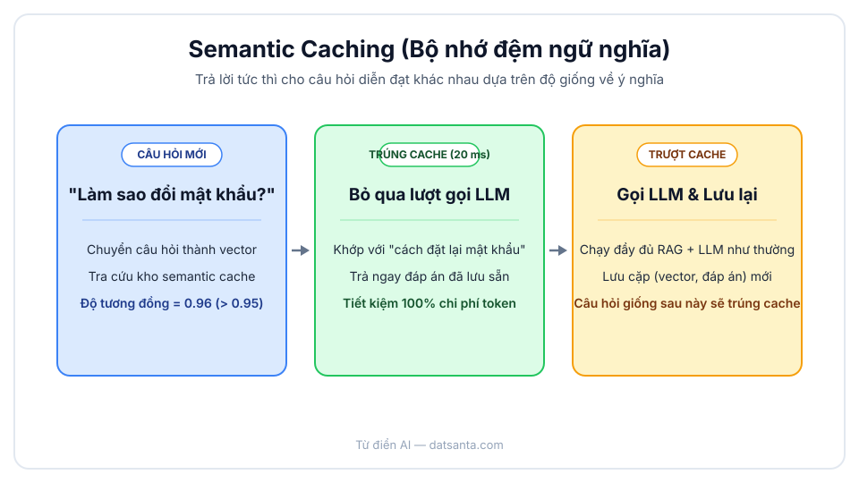

# Semantic Caching (Bộ nhớ đệm ngữ nghĩa)

**Semantic caching** lưu lại các câu trả lời LLM trước đó theo *ý nghĩa* (vector embedding) của câu hỏi, giúp những câu hỏi mới diễn đạt hơi khác vẫn nhận ngay đáp án từ cache mà không cần gọi lại LLM.

## Ví dụ thực tế

Cache truyền thống như Redis chỉ trúng khi hai chuỗi giống nhau từng ký tự (`"đổi mật khẩu"` sẽ trượt khi người dùng gõ `"làm sao đổi mật khẩu vậy?"`). Semantic caching biến câu hỏi mới thành vector, kiểm tra độ tương đồng vượt ngưỡng (vd: `0.95`) và trả về câu trả lời đã kiểm chứng chỉ trong 20 ms—giảm mạnh chi phí API và độ trễ cho các câu hỏi lặp lại.

## Đừng nhầm với

- **[Prompt Caching](prompt-caching.md):** Prompt caching tái sử dụng *phần mở đầu prompt* (như system prompt) bên trong máy chủ hãng AI nhưng vẫn phải chạy bước sinh chữ; semantic caching bỏ qua hoàn toàn lượt gọi LLM cho câu hỏi tương tự.

## Thuật ngữ liên quan

- [Embeddings](embeddings.md)
- [Prompt Caching](prompt-caching.md)
- [Cost per Task](cost-per-task.md)
