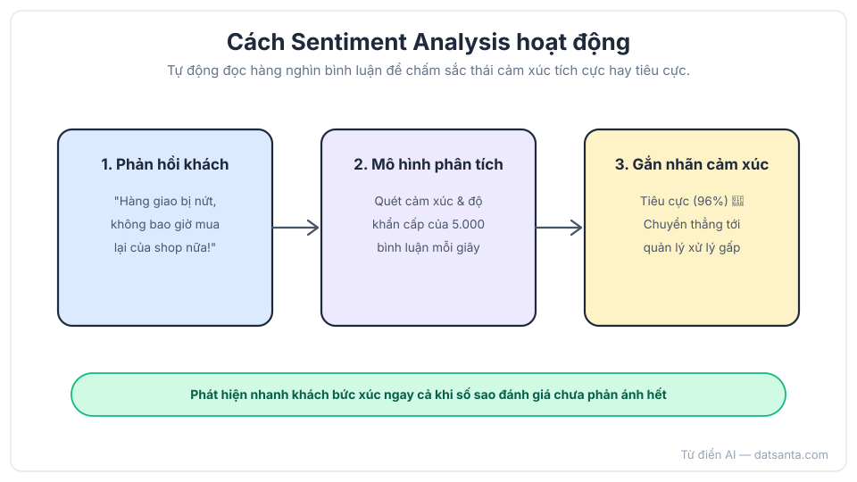

# Sentiment Analysis (Phân tích cảm xúc)

**Sentiment analysis** là kỹ thuật AI đọc văn bản — như đánh giá sản phẩm, bình luận mạng xã hội hay phiếu hỗ trợ — rồi nhận diện sắc thái cảm xúc ẩn sau đó: tích cực, tiêu cực hay trung lập.

## Ví dụ thực tế

Giả sử một cửa hàng online nhận 5.000 bình luận sau ngày ra mắt sản phẩm mới. Không ai đủ sức ngồi đọc hết cả 5.000 dòng trong một buổi chiều.

Sentiment analysis quét toàn bộ trong vài giây, gắn nhãn *"Pin trâu dùng cả tuần!"* là Tích cực, *"Hàng giao bị nứt, không bao giờ mua lại"* là Tiêu cực (khẩn cấp!), rồi đẩy ngay các ca bức xúc lên đầu hàng cho quản lý xử lý.

## Đừng nhầm với

- **Số sao đánh giá:** Khách có thể chấm 3 sao nhưng lại viết *"Giao hàng quá tệ, hộp rách nát"* — sentiment analysis đọc hiểu cảm xúc trong câu chữ chứ không chỉ nhìn con số.
- **Tóm tắt bằng [LLM](llm.md):** Sentiment analysis chuyên chấm điểm cảm xúc; các LLM hiện đại có thể vừa phân loại cảm xúc vừa giải thích *vì sao* khách hàng bực mình.

## Thuật ngữ liên quan

- [NLP](nlp.md)
- [Machine Learning](machine-learning.md)
- [AI Workflow](ai-workflow.md)
