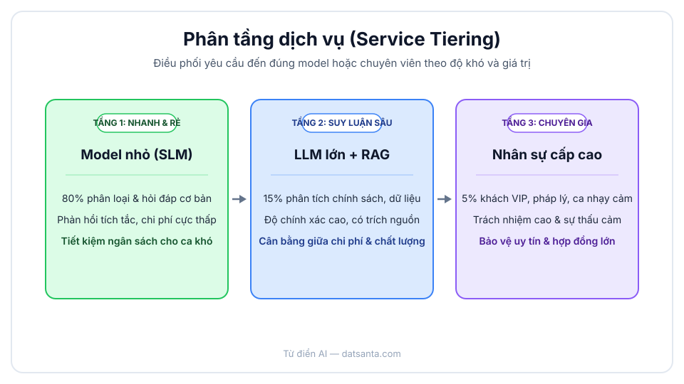

# Service Tiering (Phân tầng dịch vụ)

**Service tiering** là chiến lược điều phối từng loại yêu cầu đến các model AI khác nhau—hoặc đến nhân sự trực tiếp—tùy theo độ khó, mức độ khẩn cấp hay giá trị khách hàng, thay vì dùng lựa chọn đắt nhất cho mọi việc.

## Ví dụ thực tế

Một hãng vận tải không dùng chuyên cơ riêng để giao từng phong bì thư thường. Thư tiêu chuẩn đi xe tải định tuyến, hợp đồng gấp đi đường hàng không nhanh, còn thiết bị dễ vỡ có xe giao riêng. Với AI, phân loại câu hỏi đơn giản dùng model nhỏ vừa nhanh vừa rẻ, rà soát hợp đồng phức tạp chuyển lên model mạnh nhất, còn khiếu nại từ khách VIP đưa thẳng cho chuyên viên cấp cao.

## Đừng nhầm với

- **[Cost per Task](cost-per-task.md):** Cost per task đo chi phí của một đầu việc; service tiering là cách chia làn xử lý thông minh để giữ chi phí thấp trên số đông mà vẫn đảm bảo chất lượng ở ca khó.

## Thuật ngữ liên quan

- [Token Budget](token-budget.md)
- [Escalation Path](escalation-path.md)
- [LLM](llm.md)
