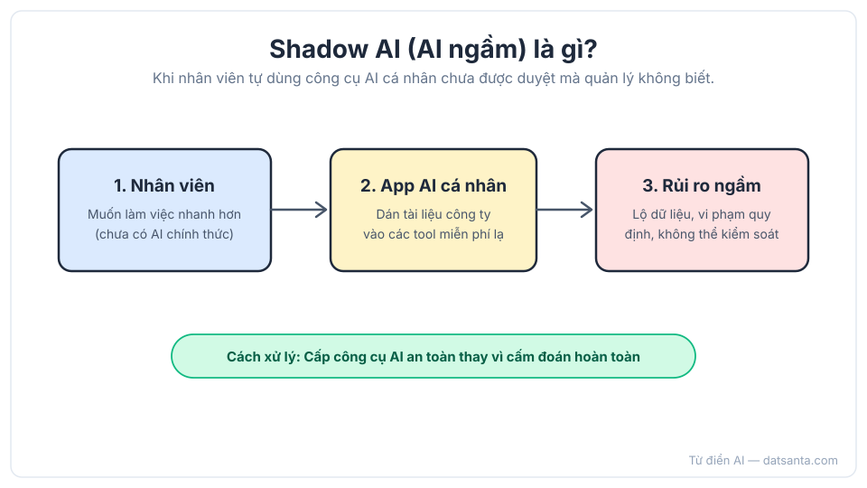

# Shadow AI (AI ngầm trong doanh nghiệp)

**Shadow AI** xảy ra khi nhân viên âm thầm dùng các công cụ AI cá nhân chưa được phê duyệt để làm việc — thường là dán thẳng tài liệu nội bộ hoặc thông tin khách hàng vào các app miễn phí mà quản lý không hề hay biết.

## Ví dụ thực tế

Nếu công ty cấm dùng lưu trữ đám mây nhưng không cấp giải pháp thay thế, nhân viên vẫn cần gửi file nặng — thế là họ tự dùng email cá nhân hoặc web chia sẻ file miễn phí.

Với AI cũng y hệt. Nhân viên muốn làm báo cáo hay viết email nhanh hơn. Nếu ban lãnh đạo chỉ cấm đoán thay vì cấp công cụ AI an toàn của công ty, nhân viên sẽ dùng tài khoản cá nhân trên điện thoại hoặc trình duyệt, tạo ra rủi ro rò rỉ dữ liệu ngoài tầm kiểm soát.

## Đừng nhầm với

- **Hành vi phá hoại:** Nhân viên dùng shadow AI hiếm khi có ý xấu; họ chỉ muốn làm việc nhanh hơn vì thiếu công cụ chính thức.
- **[AI governance](ai-governance.md):** Governance là bộ quy tắc rõ ràng và danh sách công cụ được cấp phép để ngăn ngừa shadow AI ngay từ đầu.

## Thuật ngữ liên quan

- [Data Privacy](data-privacy.md)
- [AI Governance](ai-governance.md)
- [Human-in-the-Loop](human-in-the-loop.md)
