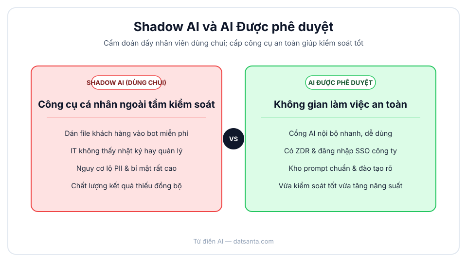

# Shadow IT / Shadow AI (Dùng AI tự phát ngoài kiểm soát)

**Shadow IT (hay Shadow AI)** xảy ra khi nhân viên tự ý dùng các công cụ AI cá nhân hoặc tiện ích trình duyệt chưa được công ty phê duyệt để làm việc mà bộ phận IT, bảo mật hay quản lý không hề hay biết.

## Ví dụ thực tế

Nếu máy pha cà phê văn phòng bị hỏng mà quy trình xin mua mới mất tận ba tháng, nhân viên sẽ tự mang ấm đun siêu tốc đến cắm chung vào ổ điện quá tải. Khi công ty cấm dùng AI hoặc duyệt công cụ quá chậm, nhân viên sẽ âm thầm mở chatbot miễn phí trên điện thoại cá nhân rồi dán biên bản họp hay hợp đồng khách hàng vào đó. Cấm đoán mà không có lựa chọn thay thế an toàn gần như chắc chắn tạo ra Shadow AI.

## Đừng nhầm với

- **[AI Adoption](ai-adoption.md):** AI adoption là việc sử dụng công cụ AI được phê duyệt, minh bạch trong quy trình công ty; Shadow AI là việc dùng chui ngoài tầm kiểm soát bảo mật.

## Thuật ngữ liên quan

- [AI Enablement](ai-enablement.md)
- [Zero Data Retention](zero-data-retention.md)
- [Data Governance](data-governance.md)
