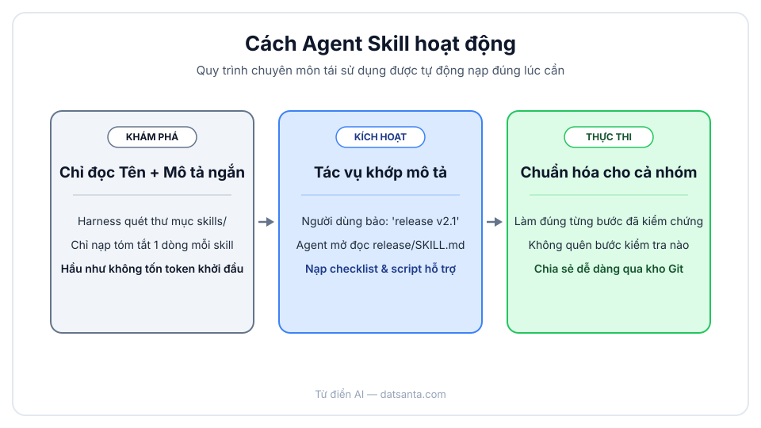

# Skill (Kỹ năng mở rộng cho Agent)

**Agent skill** là một thư mục tái sử dụng chứa hướng dẫn chuyên môn, biểu mẫu và script hỗ trợ mà coding [harness](harness.md) tự động nhận diện và chỉ nạp vào khi tác vụ của người dùng khớp với mô tả của skill đó.

## Ví dụ thực tế

Hãy hình dung cuốn sổ công thức trên kệ bếp: đầu bếp không cần học thuộc lòng mọi món tráng miệng dịp lễ mỗi sáng, nhưng hễ khách gọi bánh kem cháy thì họ rút ngay đúng tờ công thức một trang ghi rõ nhiệt độ và từng bước làm. Skill áp dụng [progressive disclosure](progressive-disclosure.md) cho AI agent—giúp đội ngũ đóng gói quy trình như `"deploy-release"` hay `"write-migration"` mà không làm nặng các phiên chat khác.

## Đừng nhầm với

- **[MCP (Model Context Protocol)](mcp.md):** MCP kết nối agent tới API và máy chủ dữ liệu bên ngoài theo thời gian thực; skill đóng gói hướng dẫn cục bộ, checklist và script dạy agent *cách thực hiện* một quy trình.

## Thuật ngữ liên quan

- [Progressive Disclosure](progressive-disclosure.md)
- [AGENTS.md](agents-md.md)
- [Harness](harness.md)
