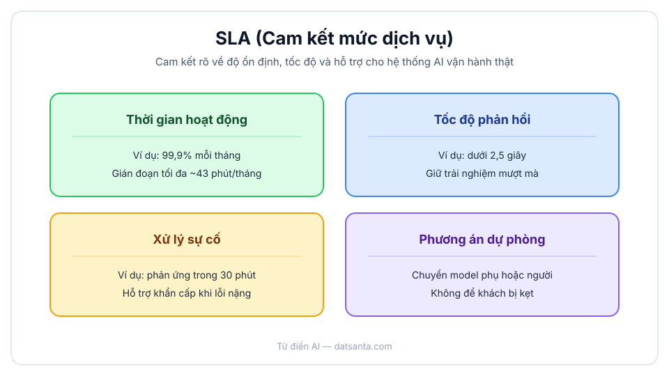

# SLA (Cam kết mức dịch vụ)

**SLA (Service Level Agreement)** là bản cam kết rõ ràng giữa nhà cung cấp AI (hoặc đội kỹ thuật nội bộ) với người dùng về chất lượng dịch vụ tối thiểu—như thời gian hệ thống hoạt động, tốc độ phản hồi và hạn mức xử lý sự cố.

## Ví dụ thực tế

Khi đặt dịch vụ giao hàng hỏa tốc, bạn được cam kết giao trong 2 giờ và hoàn phí nếu trễ hẹn. Trong doanh nghiệp, SLA cho hệ thống AI hỗ trợ khách hàng có thể quy định: thời gian hoạt động đạt 99,9% mỗi tháng, câu trả lời phải xuất hiện dưới 3 giây và mọi lỗi nghiêm trọng phải được kỹ sư xử lý trong vòng 30 phút. SLA giúp đội vận hành yên tâm đưa AI vào quy trình thật.

## Đừng nhầm với

- **[Guardrails](guardrails.md):** Guardrails là hàng rào kỹ thuật ngăn AI nói sai hoặc lộ dữ liệu nhạy cảm; SLA là cam kết đo lường về độ ổn định, tốc độ và trách nhiệm hỗ trợ.

## Thuật ngữ liên quan

- [Latency vs. Throughput](latency-vs-throughput.md)
- [Escalation Path](escalation-path.md)
- [Vendor Lock-in](vendor-lock-in.md)
