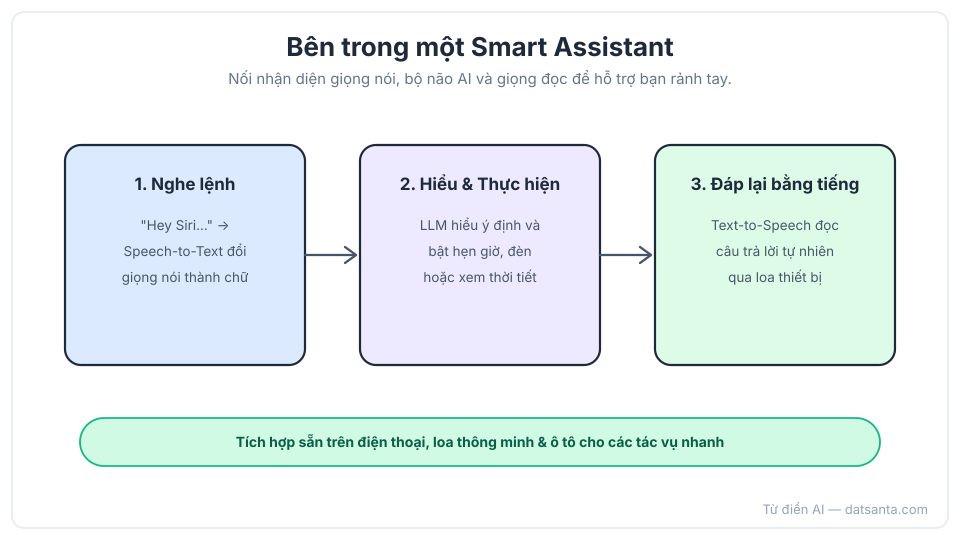

# Smart Assistant (Trợ lý thông minh)

**Smart assistant** (như Siri, Google Assistant hay Alexa) là trợ lý phần mềm kích hoạt bằng giọng nói hoặc chữ viết trên điện thoại, loa thông minh hay ô tô giúp bạn hỏi đáp nhanh và điều khiển các tác vụ trên thiết bị.

## Ví dụ thực tế

Chỉ cần nói *"Hey Siri, hẹn giờ luộc mì 10 phút và tắt đèn phòng khách"*, bạn có thể xử lý việc vặt rảnh tay ngay khi đang bận nấu ăn.

Trợ lý thông minh đời cũ chỉ hiểu các câu lệnh thuộc lòng cứng nhắc, đổi cách hỏi một chút là báo lỗi. Các phiên bản hiện đại kết hợp [speech-to-text](speech-to-text.md), [LLM](llm.md) và [text-to-speech](text-to-speech.md) để trò chuyện tự nhiên và xử lý yêu cầu nhiều bước.

## Đừng nhầm với

- **[Chatbot](chatbot.md):** Chatbot nằm trong trình duyệt hoặc app chat để đọc–viết; smart assistant gắn sâu vào báo thức, cuộc gọi, đèn nhà thông minh và từ khóa đánh thức bằng giọng nói.
- **Trợ lý con người:** Smart assistant rất giỏi đặt nhắc nhở, xem thời tiết và tra nhanh, nhưng vẫn cần bạn xác nhận kỹ trước khi gửi tin nhắn quan trọng hay thanh toán.

## Thuật ngữ liên quan

- [Speech-to-Text](speech-to-text.md)
- [Text-to-Speech](text-to-speech.md)
- [Chatbot](chatbot.md)
- [AI Agent](ai-agent.md)
