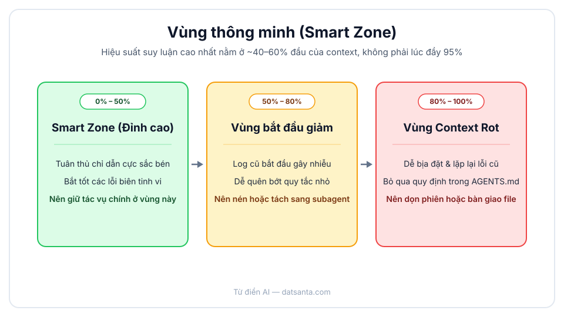

# Smart Zone (Vùng thông minh của ngữ cảnh)

**Smart zone** là khoảng dung lượng lý tưởng trong [context window](context-window.md) của LLM (thường là 40–60% đầu tiên) nơi model tuân thủ chỉ dẫn sắc bén nhất, bắt lỗi tinh vi tốt nhất và suy luận ổn định trước khi bị nhiễu làm giảm chất lượng.

## Ví dụ thực tế

Một chiếc bàn làm việc về lý thuyết chất được 50 chồng hồ sơ trước khi rơi xuống đất, nhưng bạn chỉ làm việc hiệu quả nhất khi trên bàn chỉ mở đúng 5 tập tài liệu cần thiết. Dù model quảng cáo context window 200k token, việc giữ phiên lập trình nằm gọn trong smart zone—nhờ dọn việc cũ, dùng [subagent](subagent.md) hay nén sớm—giúp câu trả lời luôn sắc bén thay vì trượt sang [context rot](context-rot.md).

## Đừng nhầm với

- **[Context Window](context-window.md):** Context window là giới hạn token tối đa về mặt kỹ thuật; smart zone là vùng dung lượng thực tế nhỏ hơn nhiều nơi trí thông minh của model giữ ở đỉnh cao.

## Thuật ngữ liên quan

- [Context Rot](context-rot.md)
- [Compaction](compaction.md)
- [Subagent](subagent.md)
