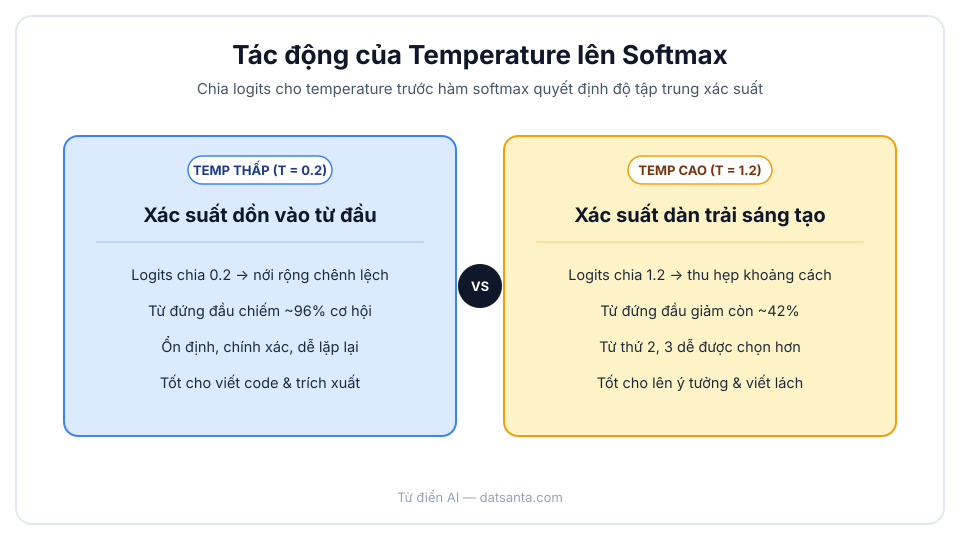

# Softmax (Hàm chuẩn hóa xác suất)

**Softmax** là hàm toán học chuyển đổi một danh sách [logits](logits.md) thô thành phân phối xác suất chuẩn, trong đó mọi giá trị đều dương và tổng tất cả đúng bằng `1.0` (`100%`).

## Ví dụ thực tế

Giả sử ba ứng dụng giao hàng có điểm đánh giá thô là `4.8`, `4.2` và `3.0`. Softmax lấy hàm mũ để làm nổi bật điểm cao hơn, rồi chia cho tổng chung để ra tỷ lệ dễ hiểu như `62%`, `31%` và `7%`. Khi LLM giải mã văn bản, [temperature](temperature.md) sẽ chia các giá trị logits *trước* khi đưa vào softmax: temperature thấp đẩy xác suất dồn sát vào từ đứng đầu, còn temperature cao làm tỷ lệ trải đều hơn.

## Đừng nhầm với

- **[Logits](logits.md):** Logits là điểm số thô đầu vào; softmax cho ra xác suất đã chuẩn hóa sẵn sàng để chọn token.

## Thuật ngữ liên quan

- [Logits](logits.md)
- [Temperature](temperature.md)
- [Top-p Sampling](top-p-sampling.md)
