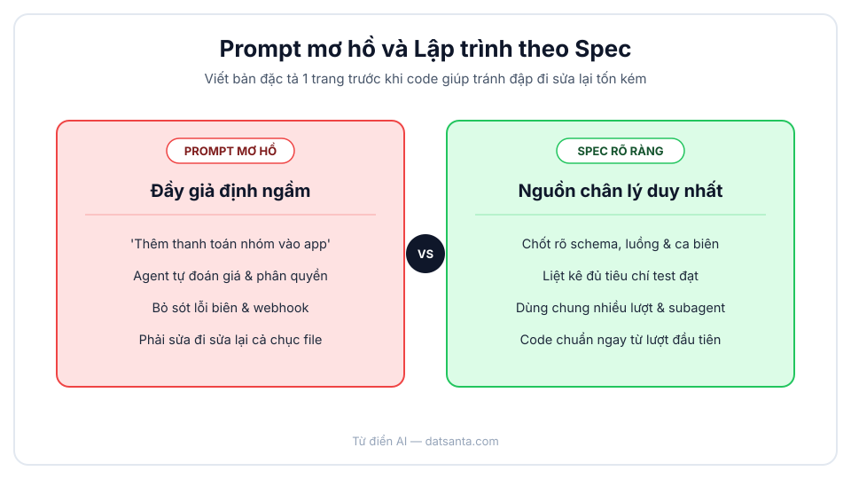

# Spec (Bản đặc tả kỹ thuật cho AI)

**Spec** là tài liệu thiết kế viết rõ ràng mô tả tính năng cần làm gì, các trường hợp biên, cấu trúc dữ liệu và tiêu chí nghiệm thu—được soạn *trước khi* yêu cầu coding agent viết mã nguồn.

## Ví dụ thực tế

Bảo thợ xây `"làm giúp tôi căn bếp thật đẹp"` gần như chắc chắn sẽ phải đập đi sửa lại; đưa bản vẽ mặt bằng một trang ghi rõ kích thước, ổ điện và vị trí thiết bị sẽ giúp thi công chuẩn ngay lượt đầu. Với AI coding agent, dành 10 phút viết bản spec chặt chẽ (thường tinh chỉnh qua [grilling](grilling.md)) giúp model không tự suy diễn ngầm và có tiêu chuẩn rõ ràng để tự kiểm thử.

## Đừng nhầm với

- **[Prompt](prompt.md):** Prompt là bất kỳ tin nhắn ngắn nào bạn gõ nhanh vào ô chat; spec là tài liệu kỹ thuật có cấu trúc, dùng làm nguồn chân lý chung xuyên suốt nhiều lượt làm việc hoặc nhiều phiên.

## Thuật ngữ liên quan

- [Grilling](grilling.md)
- [AFK Agent](afk-agent.md)
- [Planning Pattern](planning-pattern.md)
