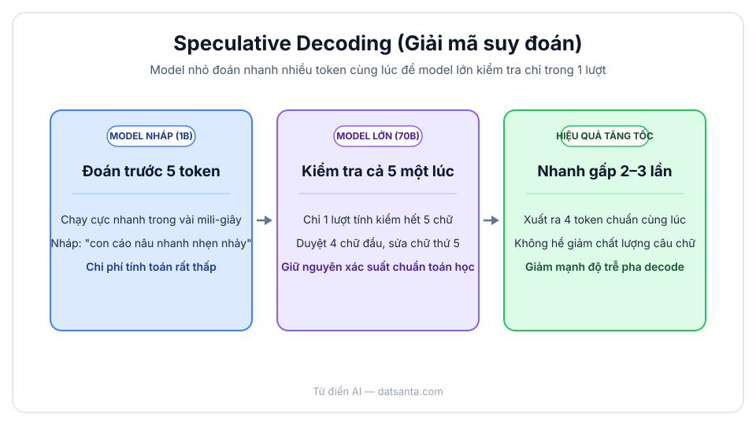

# Speculative Decoding (Giải mã suy đoán)

**Speculative decoding** tăng tốc sinh văn bản cho LLM bằng cách cho một model nháp siêu nhỏ chạy trước đoán nhanh vài token tiếp theo, rồi model lớn kiểm chứng tất cả các token đó cùng lúc chỉ trong một lượt tính.

## Ví dụ thực tế

Hãy hình dung một biên tập viên kỳ cựu làm việc cùng thư ký đánh máy cực nhanh. Thay vì đọc từng chữ một cho thư ký gõ, thư ký tự gõ nháp luôn cả câu tiếp theo trong nửa giây. Biên tập viên liếc một lượt là duyệt ngay 6 từ đúng và chỉ sửa lại từ thứ 7. Kết quả đầu ra vẫn giữ nguyên chuẩn toán học của model lớn nhưng tốc độ nhanh gấp 2–3 lần.

## Đừng nhầm với

- **[Model Routing](model-routing.md):** Model routing đẩy câu dễ sang model nhỏ và câu khó sang model lớn; speculative decoding kết hợp cả hai model trong *mọi* lượt trả lời mà không đánh đổi chất lượng của model lớn.

## Thuật ngữ liên quan

- [TPS (Tokens per Second)](tps.md)
- [Prefill and Decode](prefill-and-decode.md)
- [Inference](inference.md)
