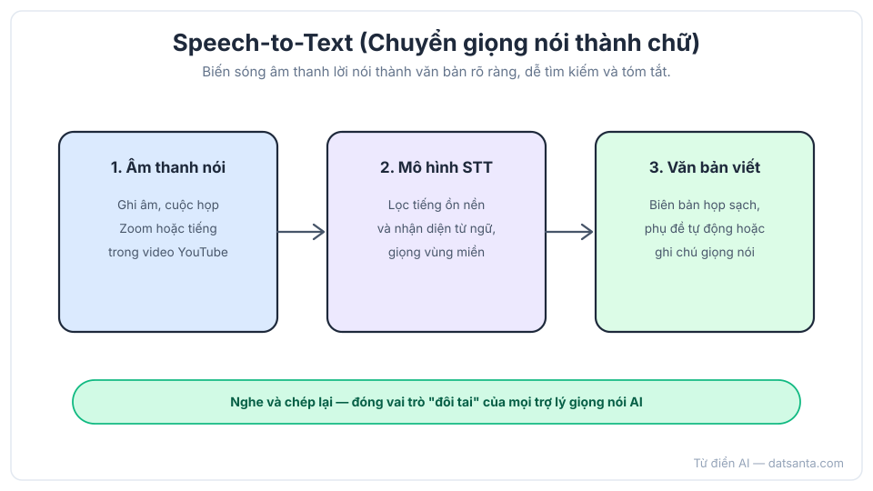

# Speech-to-Text (Chuyển giọng nói thành chữ)

**Speech-to-text (STT)** là công nghệ AI nghe âm thanh giọng nói và chuyển thành văn bản viết — đứng sau tính năng ghi biên bản cuộc họp, gõ văn bản bằng giọng nói và phụ đề tự động.

## Ví dụ thực tế

Khi bạn bấm biểu tượng micro trên điện thoại để đọc tin nhắn, bật phụ đề tự động trên YouTube, hoặc ghi âm cuộc họp Zoom để xuất biên bản, speech-to-text chính là thứ đang lắng nghe.

Các mô hình STT hiện đại (như Whisper) xử lý tốt cả giọng vùng miền, tiếng ồn quán cà phê và câu nói xen lẫn tiếng Anh – Việt, xuất ra văn bản sạch để [LLM](llm.md) tóm tắt ngay lập tức.

## Đừng nhầm với

- **[Text-to-speech](text-to-speech.md):** Speech-to-text đổi *giọng nói thành chữ viết* (nghe và chép); text-to-speech làm ngược lại, đổi *chữ thành giọng đọc* (nói ra tiếng).
- **Trợ lý giọng nói:** Một trợ lý giọng nói hoàn chỉnh nối 3 bước: speech-to-text (nghe) → [LLM](llm.md) (nghĩ) → text-to-speech (trả lời bằng tiếng).

## Thuật ngữ liên quan

- [Text-to-Speech](text-to-speech.md)
- [Multimodal AI](multimodal-ai.md)
- [NLP](nlp.md)
